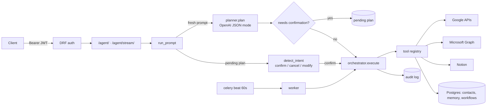

# Architecture

One Django project backed by PostgreSQL, with Redis as cache and Celery broker, and Celery worker and beat processes for scheduled work.

## Request flow

1. **Authentication** (`authentication/authentication.py`). It verifies an HS256 JWT (issuer `<SUPABASE_URL>/auth/v1`, audience `authenticated`) and creates a local `User` for a new `sub`.
2. **Agent view** (`agent/views.py`). It validates input, rate-limits, and resolves the optional conversation (`project_id`).
3. **`run_prompt`** handles three cases:
   - Capability questions are answered from the registry with no LLM call.
   - A pending plan routes the reply through intent detection.
   - A fresh prompt is sent to the planner.
4. **Planner** (`planner/planner.py`). It prompts the LLM with the tool schemas the user can access, the connected accounts, up to 20 memories, and conversation history. It returns a `Plan`: ordered `steps` (`tool`, `params`, `output_var`, optional `account_id`), plus `final_output_var` and a `summary`. Non-executable plans fall back to a direct answer. History-free prompts are cached for `PLAN_CACHE_TTL` seconds.
5. **Orchestrator** (`orchestrator/orchestrator.py`). It runs the steps in order. For each step it:
   - resolves `$var` and `$input.name` references from earlier outputs;
   - loads and, if needed, refreshes the integration credential and injects `token_data`;
   - calls the tool under a `TOOL_STEP_TIMEOUT` deadline, retrying up to 3 times (1s, 2s, 4s) on connection errors, `requests` timeouts, HTTP 429, and 5xx;
   - records an audit row for confirmation-required tools.

   The last step is normally `processing_llm`, which writes the reply.

## Tools and integrations

- **Tool** (`tools/registry.py`). A `ToolDef` holds a name, a parameter schema shown to the planner, an async function, the integration it needs (`plugin_id`), and flags (`requires_confirmation`, `requires_user_id`). Every subpackage of `tools/` registers its tools when Django starts (`tools/apps.py`). See [tools.md](tools.md).
- **Integration** (`plugins/plugins/registry.py`). A user-connected account type with its OAuth configuration (endpoints, scopes, client-ID variables, account-ID lookup). There are 7: `gmail`, `google_calendar`, `google_contacts`, `google_drive`, `outlook`, `outlook_calendar`, `notion`.
- **Credentials** (`plugins/services/credentials.py`, `plugins/models.py`). `Credentials` rows store Fernet-encrypted access and refresh tokens per user, integration, and account. Tokens are refreshed when they are within 60 seconds of expiry. A failed refresh marks the row `error`, and later calls report the integration as not connected.
- **OAuth flow.** `connect` creates a signed, single-use state. The public `callback` exchanges the code and stores the result pending. The authenticated `finalize` call binds it to the user who started the flow.

## Background work

`workflows` stores saved plans (`SavedWorkflow`) and cron schedules (`ScheduledRun`, with an IANA time zone). Every 60 seconds, Celery beat runs `dispatch_due_scheduled_runs`, which:
1. locks due rows (`SELECT … FOR UPDATE SKIP LOCKED`);
2. creates `ScheduledRunExecution` rows;
3. advances `next_run_at`;
4. enqueues `run_scheduled_run`.

The worker executes the saved plan through the same orchestrator and records success or failure. Scheduled and direct workflow runs do not ask for confirmation.

## Persistence

| Model | App | Purpose |
|---|---|---|
| `User` | authentication | Local user keyed by `supabase_uid` |
| `Credentials`, `OAuthState` | plugins | Encrypted integration tokens; pending OAuth state |
| `Projects`, `ProjectContext` | projects, context | Conversations, message history, pending plan |
| `Task`, `SubTask` | tasks | Record of each agent run and its steps |
| `AgentAction`, `PlannerUsage`, `UserMemory` | agent | Audit log, LLM token usage, persistent memories |
| `SavedWorkflow`, `ScheduledRun`, `ScheduledRunExecution` | workflows | Workflows and schedule history |
| `Contact`, `ContactConnection` | contacts | Local address book |

Without `REDIS_URL`, pending plans for requests with no `project_id` live in a per-process memory cache.
