# Backend Flow Reference

This document traces the main backend flows from request entry to final response. It is based on the current code paths, not intended architecture.

Covered flows:

- Supabase login handoff to backend authentication
- First request / new local user creation
- Plugin OAuth connection
- Agent prompt with a normal LLM response
- Agent prompt with tool calls
- Agent prompt with confirmation-required actions
- Saved workflow validation and execution
- Scheduled recurring workflow execution with Celery and Redis

Important terminology:

- **Supabase user**: the user account created and authenticated by Supabase Auth.
- **Local user**: the Django row in `Users`, linked to Supabase by `supabase_uid`.
- **Plugin credential**: encrypted OAuth tokens stored in `PluginCredentials`.
- **Project plugin gate**: `projects.plugins`, a JSON object that controls which plugin-backed tools are visible to the planner for that project.
- **Plan**: a `planner.schemas.Plan` object, not a row in the `tasks` table.
- **Task table**: the `tasks` and `sub_tasks` tables are both CRUD resources and lightweight agent execution records. For non-dry-run executed plans with a project, `/agent/` creates one `Task` and one `SubTask` per plan step, then marks the task `completed` or `failed`.
- **Saved workflow**: a persisted `Plan` JSON plus optional `input_schema`, owned by a user and optionally linked to a project.
- **Scheduled run**: a cron/timezone wrapper around a saved workflow. Celery Beat dispatches due runs, Celery workers execute them, and Redis is the Celery broker.

## Global Request Entry Points

Top-level routing starts in:

1. `backend/urls.py`
2. App-specific `urls.py`
3. App `views.py`

Primary routes:

| Endpoint | Purpose | Auth |
| --- | --- | --- |
| `POST /agent/` | Synchronous agent prompt | Supabase bearer token |
| `POST /agent/stream/` | SSE streaming agent prompt | Supabase bearer token, manually authenticated |
| `GET /agent/actions/` | Confirmed-action audit log | Supabase bearer token |
| `DELETE /agent/reset/<project_id>/` | Clear project conversation and pending plan | Supabase bearer token |
| `GET/POST /agent/memory/` | List or upsert persistent user memories | Supabase bearer token |
| `PUT/DELETE /agent/memory/<memory_id>/` | Update or delete one user memory | Supabase bearer token |
| `GET /tools/` | List tool schemas usable by the current user | Supabase bearer token |
| `GET/POST /workflows/` | List or create saved workflows | Supabase bearer token |
| `POST /workflows/validate/` | Validate workflow plan/input schema without saving | Supabase bearer token |
| `GET/PUT/DELETE /workflows/<workflow_id>/` | Saved workflow detail/update/delete | Supabase bearer token |
| `POST /workflows/<workflow_id>/run/` | Execute a saved workflow without LLM replanning | Supabase bearer token |
| `GET/POST /scheduled-runs/` | List or create recurring scheduled workflow runs | Supabase bearer token |
| `GET/PUT/DELETE /scheduled-runs/<scheduled_run_id>/` | Scheduled run detail/update/delete | Supabase bearer token |
| `POST /scheduled-runs/<scheduled_run_id>/run-now/` | Queue one immediate scheduled-run execution | Supabase bearer token |
| `GET /scheduled-runs/<scheduled_run_id>/executions/` | List scheduled-run execution history | Supabase bearer token |
| `GET/POST /projects/` | List/create projects | Supabase bearer token |
| `GET/PUT/DELETE /projects/<projectId>/` | Project detail/update/delete | Supabase bearer token |
| `GET /plugins/registry/` | List connectable plugins | Supabase bearer token |
| `POST /plugins/oauth/connect/` | Start OAuth for a plugin | Supabase bearer token |
| `GET /plugins/oauth/callback/<plugin_key>/` | Provider OAuth callback | Public |
| `POST /plugins/oauth/finalize/` | Commit pending OAuth result after app deep link | Supabase bearer token |
| `GET /plugins/credentials/` | List redacted credentials | Supabase bearer token |
| `GET/PUT/PATCH/DELETE /plugins/credentials/<pk>/` | Credential detail/update/delete | Supabase bearer token |
| `POST /plugins/credentials/<pk>/refresh/` | Refresh one credential | Supabase bearer token |
| `POST /plugins/credentials/<pk>/disconnect/` | Revoke and delete one credential | Supabase bearer token |
| `GET/POST /project-context/<projectId>/` | List/append conversation context | Supabase bearer token |
| `DELETE /project-context/<projectId>/clear/` | Clear project context | Supabase bearer token |
| `POST /project-context/<projectId>/trim/` | Trim project context | Supabase bearer token |
| `GET/POST /tasks/<projectId>/` | List/create tasks | Supabase bearer token |
| `GET/PATCH/DELETE /tasks/<projectId>/<taskId>/` | Task detail/update/delete | Supabase bearer token |
| `POST /tasks/<projectId>/<taskId>/subtasks/` | Create subtask | Supabase bearer token |

## Shared Authentication Flow

The backend does not have its own login endpoint. The frontend logs into Supabase directly, then sends the Supabase access token to backend endpoints.

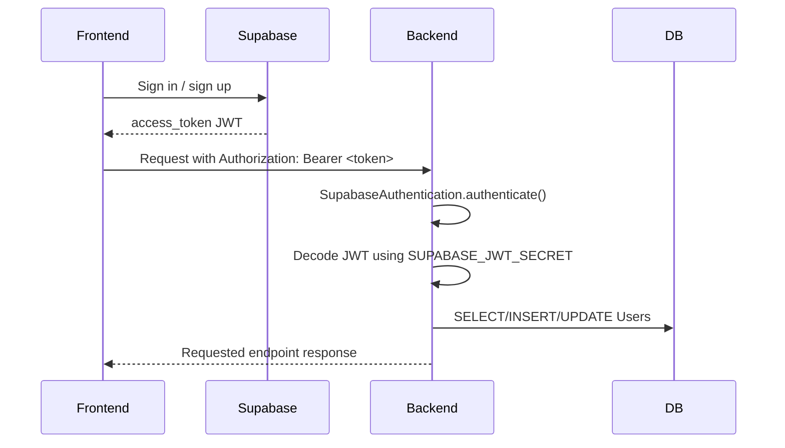

Files hit in order for any protected endpoint:

1. `backend/settings.py`
   - Configures `REST_FRAMEWORK.DEFAULT_AUTHENTICATION_CLASSES`.
   - Uses `authentication.authentication.SupabaseAuthentication`.
   - Reads `SUPABASE_URL`, `SUPABASE_JWT_SECRET`, and optional `SUPABASE_JWT_AUDIENCE`.
2. `backend/urls.py`
   - Routes the request to the target view.
3. Target app view
   - Uses `permission_classes = [IsAuthenticated]` or `@permission_classes([IsAuthenticated])`.
4. `authentication/authentication.py`
   - `SupabaseAuthentication.authenticate()`.
   - `_decode_access_token()`.
   - `_sync_user_from_supabase_claims()`.
5. `authentication/models.py`
   - `UserManager.create_user()` if a new local row is needed.
6. Target view continues with `request.user` populated.

Database interactions:

| Table | Operation | Why |
| --- | --- | --- |
| `Users` | `SELECT ... WHERE supabase_uid = <jwt sub>` with row lock inside transaction | Find existing local user |
| `Users` | `INSERT` | First backend request by a Supabase user creates the local user |
| `Users` | `UPDATE email` | Existing `supabase_uid` user can get a new unclaimed token email |

Important current behavior:

- `Users.supabase_uid` is required and unique.
- `Users.email` is required and unique.
- If the JWT has no email, the backend stores a deterministic synthetic email: `<supabase_uid>@users.invalid`.
- If no row exists for the incoming `supabase_uid`, the backend creates one. It does not claim old email-only rows because `supabase_uid` is now required.
- If an existing `supabase_uid` user has a changed email and that email is already owned by another user, auth fails with a generic `"Invalid or expired token"` response.
- If JWT validation fails, auth fails before the target view runs.

## Flow 1: Login

Login happens outside this Django backend.

Start:

1. User opens the app.
2. Frontend calls Supabase Auth.
3. Supabase returns an access token.
4. Frontend stores that token and sends it to Django as:

```http
Authorization: Bearer <supabase_access_token>
```

Backend files involved:

1. None during the actual Supabase login.
2. `authentication/authentication.py` only runs when the frontend calls a backend endpoint with the token.

Backend database interactions:

- None during Supabase login itself.
- The local `Users` row is created or updated on the first authenticated backend request after login.

End:

- The frontend has a Supabase JWT.
- The backend knows nothing until a protected backend endpoint is called.

## Flow 2: New User First Backend Request

This flow happens the first time a Supabase-authenticated user calls any protected backend endpoint, such as `GET /projects/`.

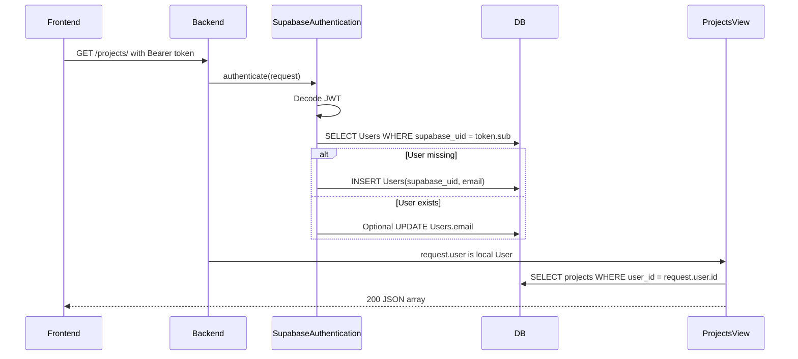

Request example:

```http
GET /projects/
Authorization: Bearer <supabase_access_token>
```

Files hit in order:

1. `backend/urls.py`
   - `path('projects/', include('projects.urls'))`
2. `projects/urls.py`
   - `path('', ProjectsListView.as_view())`
3. `projects/views.py`
   - `ProjectsListView.permission_classes = [IsAuthenticated]`
4. `authentication/authentication.py`
   - `SupabaseAuthentication.authenticate()`
   - `_decode_access_token()`
   - `_sync_user_from_supabase_claims()`
   - `_sync_user_once()`
5. `authentication/models.py`
   - `UserManager.create_user()` if no user exists.
6. `projects/views.py`
   - `Projects.objects.filter(user=request.user)`
7. `projects/serializers.py`
   - `ProjectsSerializer(projects, many=True)`

Database interactions:

| Table | Operation |
| --- | --- |
| `Users` | Select by `supabase_uid` |
| `Users` | Insert new row if missing |
| `Users` | Optional email update for existing user |
| `projects` | Select projects owned by local user |

End:

- Local user exists in `Users`.
- The endpoint returns normally, for example `[]` for a new user with no projects.

## Flow 3: Project Creation And Plugin Gate Setup

Most agent calls should include a `project_id`. Projects also carry the plugin gate used to filter planner-visible tools.

Start:

```http
POST /projects/
Authorization: Bearer <token>
Content-Type: application/json

{
  "name": "Demo Project",
  "description": "Local testing",
  "plugins": {
    "gmail": true,
    "google_calendar": false,
    "google_drive": true,
    "outlook": false
  },
  "activeContextFrom": 0
}
```

Files hit in order:

1. `backend/urls.py`
2. `projects/urls.py`
3. `authentication/authentication.py`
4. `projects/views.py`
   - `ProjectsListView.post()`
5. `projects/serializers.py`
   - Validates `ProjectsSerializer`.
6. `projects/models.py`
   - Saves `Projects`.

Database interactions:

| Table | Operation |
| --- | --- |
| `Users` | Auth lookup/sync |
| `projects` | Insert project row |

Important fields:

- `projects.user_id`: owner.
- `projects.plugins`: controls planner tool visibility.
- `projects.activeContextFrom`: lower bound for context rows loaded into the agent's LLM context.
- `projects.pending_plan`: stores a confirmation-required plan awaiting the user's next reply.

End:

- Response is `201` with the created project.
- Future `/agent/` calls can pass `"project_id": <id>`.

## Flow 4: Connect A New Plugin Through OAuth

This is the Gmail / Google Calendar / Google Drive / Google Contacts / Outlook connection flow.

Current plugin registry keys:

| Plugin key | Display | Callback path | Account label |
| --- | --- | --- | --- |
| `gmail` | Google / Gmail | `/plugins/oauth/callback/gmail/` | Gmail profile `emailAddress` |
| `google_calendar` | Google Calendar | `/plugins/oauth/callback/google_calendar/` | `None` |
| `google_drive` | Google Drive | `/plugins/oauth/callback/google_drive/` | Drive About API `user.emailAddress` |
| `google_contacts` | Google Contacts | `/plugins/oauth/callback/google_contacts/` | Google userinfo `email` |
| `outlook` | Outlook Mail | `/plugins/oauth/callback/outlook/` | Microsoft Graph `userPrincipalName` |
| `outlook_calendar` | Outlook Calendar | `/plugins/oauth/callback/outlook_calendar/` | Microsoft Graph `userPrincipalName` |
| `notion` | Notion | `/plugins/oauth/callback/notion/` | Notion `GET /v1/users/me` bot user `id` (== bot_id) |

Notion notes: its token endpoint requires HTTP Basic auth + a JSON body (registry flag `token_auth_style="basic_json"`, handled in `CredentialService.exchange_code`), tokens never expire and carry no refresh token (flag `token_never_expires=True`, so `OAuthCallbackView` skips the default 3600s expiry), and `account_id_endpoint.headers` injects the required `Notion-Version` header.

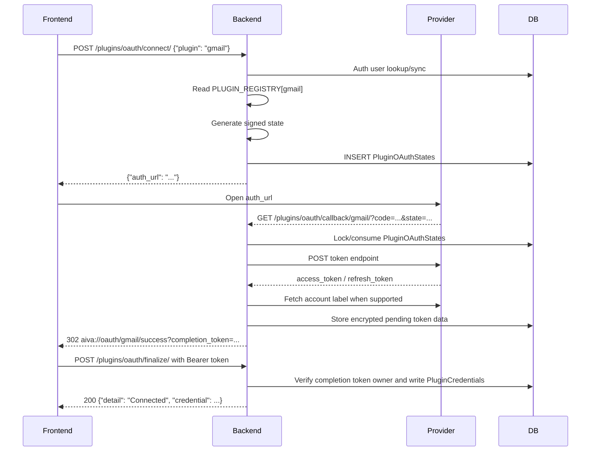

### Step 4A: Start OAuth

Request:

```http
POST /plugins/oauth/connect/
Authorization: Bearer <token>
Content-Type: application/json

{
  "plugin": "gmail"
}
```

Files hit in order:

1. `backend/urls.py`
   - `path('plugins/', include('plugins.urls'))`
2. `plugins/urls.py`
   - `path("oauth/connect/", StartConnectView.as_view())`
3. `authentication/authentication.py`
   - Authenticates `request.user`.
4. `plugins/views.py`
   - `StartConnectView.post()`
   - `ConnectSerializer`
   - Reads `PLUGIN_REGISTRY[plugin_key]`
   - Reads provider client ID from `settings`
   - `_build_redirect_uri()`
5. `plugins/services/credentials.py`
   - `CredentialService.generate_state(request.user, plugin_key)`
6. `plugins/views.py`
   - Builds provider authorization URL.

Database interactions:

| Table | Operation |
| --- | --- |
| `Users` | Auth lookup/sync |

No credential is stored yet. The user has only received a provider authorization URL.

Response:

```json
{
  "auth_url": "https://accounts.google.com/o/oauth2/v2/auth?..."
}
```

Important settings:

- `PUBLIC_BACKEND_URL`: used to build the provider-facing backend callback origin.
- `GOOGLE_CLIENT_ID` / `GOOGLE_CLIENT_SECRET`: used by Google-backed plugins.
- `MICROSOFT_CLIENT_ID` / `MICROSOFT_CLIENT_SECRET`: used by Microsoft-backed Outlook plugins.

### Step 4B: Provider Callback

The OAuth provider redirects to:

```http
GET /plugins/oauth/callback/<plugin_key>/?code=<code>&state=<state>
```

This endpoint is public because the OAuth provider calls it directly.

Files hit in order:

1. `backend/urls.py`
2. `plugins/urls.py`
   - `path("oauth/callback/<str:plugin_key>/", OAuthCallbackView.as_view())`
3. `plugins/views.py`
   - `OAuthCallbackView.permission_classes = [AllowAny]`
   - Reads `code`, `state`, and `error`.
4. `plugins/services/credentials.py`
   - `CredentialService.validate_state_and_get_oauth_state(state, plugin_key)`
   - Verifies signed state and max age.
   - Loads and locks the matching `PluginOAuthStates` row by nonce.
   - Verifies plugin match, expiry, and unused status.
   - Consumes the state row and returns it with its initiating user.
5. `plugins/views.py`
   - Reads plugin config from `PLUGIN_REGISTRY`.
   - Rebuilds callback URI with `_build_redirect_uri()`.
6. `plugins/services/credentials.py`
   - `CredentialService.exchange_code(plugin_key, code, redirect_uri)`
   - Calls provider token endpoint.
7. `plugins/services/credentials.py`
   - `CredentialService.fetch_account_id(plugin_key, access_token)`
   - Gmail calls `https://gmail.googleapis.com/gmail/v1/users/me/profile`.
   - Google Drive calls `https://www.googleapis.com/drive/v3/about`.
   - Google Calendar currently returns `None`.
8. `plugins/views.py`
   - `CredentialService.store_pending_oauth_result(...)`
   - Stores encrypted pending access/refresh tokens on `PluginOAuthStates`.
   - Redirects to the success app deep link with `completion_token=<opaque-token>`.

### Step 4C: App Finalizes OAuth

After the deep link reopens the app, the app calls:

```http
POST /plugins/oauth/finalize/
Authorization: Bearer <supabase-access-token>

{
  "plugin": "gmail",
  "completion_token": "<token-from-success-deep-link>"
}
```

Files hit in order:

1. `backend/urls.py`
2. `plugins/urls.py`
   - `path("oauth/finalize/", OAuthFinalizeView.as_view())`
3. `plugins/views.py`
   - `OAuthFinalizeView.permission_classes = [IsAuthenticated]`
   - Validates `plugin` and `completion_token`.
4. `plugins/services/credentials.py`
   - `CredentialService.finalize_oauth_connection(user, plugin_key, completion_token)`
   - Locks the pending `PluginOAuthStates` row.
   - Verifies the authenticated user matches the user that started OAuth.
   - Verifies the pending result is unused and unexpired.
   - Writes `PluginCredentials` with `update_or_create(...)`.
   - Clears pending access/refresh tokens and invalidates the completion token.

Database interactions:

| Table | Operation |
| --- | --- |
| `PluginOAuthStates` | Select/lock one-time state by nonce, set `consumed_at`, store pending encrypted token data, then clear pending tokens on finalize |
| `Users` | Select initiating user referenced by the OAuth state row |
| `PluginCredentials` | Insert or update by `(user, plugin, account_id)` during authenticated finalize |

Stored credential fields:

- `user`
- `plugin`
- `account_id`
- `access_token`
- `refresh_token`
- `expires_at`
- `scopes`
- `status = "active"`

Token storage:

- `plugins/models.py` uses `EncryptedTextField` for `access_token` and `refresh_token`.
- Encryption key comes from `CREDENTIAL_ENCRYPTION_KEY` / `CREDENTIAL_ENCRYPTION_KEYS`.

Callback result:

| Branch | Response |
| --- | --- |
| Missing `code` or `state` | `302` to `PLUGIN_OAUTH_FAILURE_REDIRECT` |
| Provider `error` | `302` to `PLUGIN_OAUTH_FAILURE_REDIRECT` |
| Invalid, expired, replayed, or plugin-mismatched state | `302` to `PLUGIN_OAUTH_FAILURE_REDIRECT` |
| Token exchange failure | `302` to `PLUGIN_OAUTH_FAILURE_REDIRECT` |
| Success | `302` to `PLUGIN_OAUTH_SUCCESS_REDIRECT` with `completion_token` query param |

Default redirect values:

```text
aiva://oauth/{plugin}/success
aiva://oauth/{plugin}/failure
```

Current security posture:

- OAuth state is signed, time-limited, server-side, and one-time.
- Credential persistence is bound to the authenticated app instance by requiring `POST /plugins/oauth/finalize/` from the initiating user before tokens are committed.
- See `docs/SECURITY_REVIEW.md` for the historical finding and current status.

## Flow 5: Agent Prompt With Normal LLM Response

A "normal response" still goes through the planner and orchestrator. The planner should produce a one-step `processing_llm` plan.

Example:

```http
POST /agent/
Authorization: Bearer <token>
Content-Type: application/json

{
  "prompt": "Explain what this app can do.",
  "project_id": 14
}
```

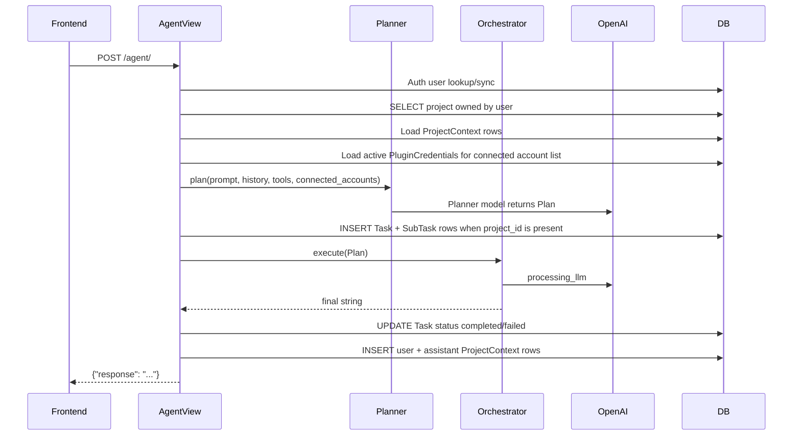

Files hit in order:

1. `backend/urls.py`
   - `path('agent/', agent_view)`
2. `agent/views.py`
   - `agent_view()`
   - `AgentRequestSerializer`
   - Looks up `Projects` when `project_id` is provided.
   - `_get_enabled_plugins(project)`
3. `authentication/authentication.py`
   - Authenticates user before view body runs.
4. `agent/views.py`
   - `async_to_sync(run_prompt)(...)`
5. `agent/chat_context.py`
   - `get_ctx(user_id, project_id)`
   - `DbContextStore.load()`
6. `tools/apps.py`
   - `ToolsConfig.ready()` auto-discovers tool packages and runs their `register(ToolDef(...))` calls.
7. `tools/registry.py`
   - `get_schemas_for_planner(enabled_plugins=enabled_plugins)`
8. `orchestrator/credentials.py`
   - `get_connected_accounts(user_id)`
9. `agent/pending_plan.py`
   - `load(user_id, project_id)`
10. `planner/planner.py`
   - `plan(...)`
   - `_build_system(...)`
   - `_call_planner(...)`
   - `_normalize_plan(...)`
11. `planner/schemas.py`
   - Validates the returned `Plan`.
12. `agent/views.py`
   - `_validate_plan_tools(...)`
   - `_validate_plan_plugins(...)`
   - `_needs_confirmation(...)`
13. `orchestrator/orchestrator.py`
   - `execute(...)`
14. `tools/processing_llm/tool.py`
   - `call_processing_llm(...)`
15. `agent/chat_context.py`
   - `ctx.add_user(prompt)`
   - `ctx.add_assistant(result)`
   - `DbContextStore.save(...)`

Database and cache interactions:

| Component | Operation |
| --- | --- |
| `Users` | Auth lookup/sync |
| `projects` | Select project by `id` and `user` |
| `project_context` | Select rows with `sequence >= projects.activeContextFrom` |
| `PluginCredentials` | Select active credentials only to tell planner what plugins/accounts are connected |
| `tasks` | Insert one execution task when `project_id` is present and `dry_run=false` |
| `sub_tasks` | Insert one subtask per plan step when a task record is created |
| `tasks` | Mark execution task `completed` or `failed` after orchestrator execution |
| Django cache | Optional plan cache lookup/write when history is empty |
| `project_context` | Insert new user message and assistant response |

Important current behavior:

- If the prompt matches the capabilities shortcut, `agent/views.py` answers from registered tool schemas without calling the planner.
- If `project_id` is provided and this is not a dry run, `agent/views.py` creates a lightweight `Task` execution record and `SubTask` rows before immediate execution.
- Fresh `plan(...)` calls currently do not persist `PlannerUsage` because `run_prompt()` does not pass `user_id` into `make_plan()`.
- `processing_llm` calls do not write `PlannerUsage`.
- No `AgentAction` row is written because `processing_llm` is not confirmation-required.

End:

```json
{
  "response": "..."
}
```

## Flow 6: Agent Prompt With Read-Only Tool Calls

This is a tool-backed prompt that does not require confirmation. Examples:

- "Get my last 2 emails and show subject lines."
- "Search my Google Drive for budget files."
- "List calendar events tomorrow."
- "What's the weather in Calgary?"

The planner produces multiple steps, usually:

1. Provider or local data tool.
2. Optional `processing_llm` transformation.
3. Final `processing_llm` answer.

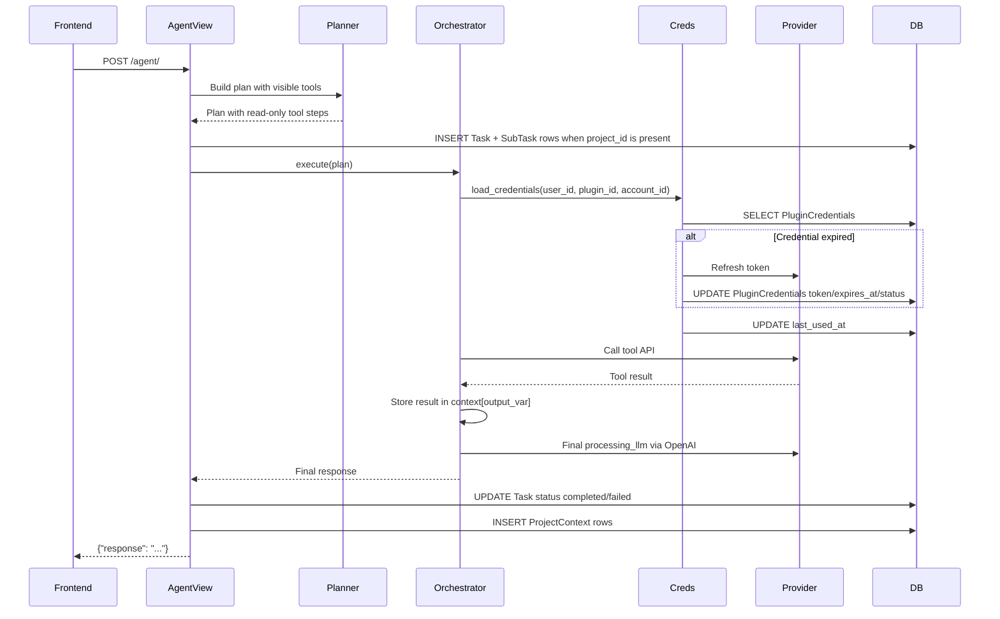

Files hit in order after the shared `/agent/` setup:

1. `planner/planner.py`
   - Produces a `Plan` with one or more tool steps.
2. `agent/views.py`
   - Validates every tool exists.
   - Validates plugin-backed tools are allowed by `project.plugins`.
   - Checks whether any tool requires confirmation.
3. `orchestrator/orchestrator.py`
   - `execute(plan, user_id, dry_run=False)`
   - Iterates each step in order.
   - Resolves `$output_var` references from prior step outputs.
4. `tools/registry.py`
   - `get(step.tool)`
5. `orchestrator/credentials.py`
   - Runs only for `ToolDef.requires_creds=True`.
   - `load_credentials(user_id, tool_def.plugin_id, step.account_id)`
6. `plugins/services/credentials.py`
   - `get_active_credential(...)`
   - `ensure_valid_credential(...)`
   - `refresh_token(...)` if expired.
   - `credential_to_token_data(...)`
7. Tool module
   - Examples:
     - `tools/gmail/api.py`
     - `tools/calendar/api.py`
     - `tools/drive/api.py`
     - `tools/weather/api.py`
     - `tools/contacts/api.py`
8. `tools/processing_llm/tool.py`
   - Usually the final step.
9. `agent/chat_context.py`
   - Persists user prompt and final response.

Database and cache interactions:

| Component | Operation |
| --- | --- |
| `PluginCredentials` | Select active credential by user/plugin/account |
| `PluginCredentials` | Update token fields if refresh is needed |
| `PluginCredentials` | Update `last_used_at` after credential validation |
| `tasks` | Insert and finish an execution task when the request has `project_id` and is not a dry run |
| `sub_tasks` | Insert one subtask per plan step when a task record is created |
| `project_context` | Insert user and assistant messages |
| Django cache | Planner cache can be used only when conversation history is empty |

No `AgentAction` row is written for read-only / non-confirmation tools.

Plugin connection failure:

1. `orchestrator/credentials.py` cannot find an active credential.
2. `orchestrator/orchestrator.py` raises `PluginNotConnectedError`.
3. `agent/views.py` returns:

```json
{
  "error": {
    "code": "plugin_not_connected",
    "message": "...",
    "plugin": "<plugin_id>"
  }
}
```

with status `422`.

Tool execution failure:

1. Tool raises an exception.
2. `orchestrator/orchestrator.py` wraps it in `ToolExecutionError`.
3. `agent/views.py` asks `processing_llm` for a friendly explanation when possible.
4. Response status is `500` with `error.code = "tool_execution_failed"`.

## Flow 7: Agent Prompt With Confirmation-Required Actions

Confirmation-required tools are external side-effect tools, such as sending email, sending drafts, trashing email, creating/updating/deleting calendar events, and deleting contacts.

Important distinction:

- This flow creates a planner `Plan`.
- It stores the pending plan in `projects.pending_plan`.
- It does not create `tasks` or `sub_tasks` rows while only asking for confirmation.
- If the user later confirms and the request has `project_id`, execution creates one `Task` row and one `SubTask` row per plan step, then marks the task `completed` or `failed`.

### Step 7A: User asks for an action

Example:

```http
POST /agent/
Authorization: Bearer <token>
Content-Type: application/json

{
  "prompt": "Send Tyler an email saying the backend image is ready.",
  "project_id": 14
}
```

Flow:

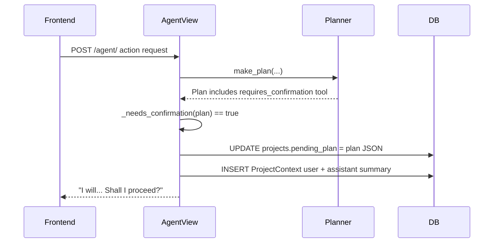

Files hit in order:

1. Same `/agent/` setup as Flow 5.
2. `planner/planner.py`
   - Produces a plan with at least one `ToolDef.requires_confirmation=True` step.
3. `agent/views.py`
   - `_needs_confirmation(new_plan)` returns `True`.
4. `agent/pending_plan.py`
   - `save(user_id, project_id, new_plan)`
5. `projects/models.py`
   - Stores plan JSON in `Projects.pending_plan`.
6. `agent/chat_context.py`
   - Stores the user's request and the assistant's plan summary in `project_context`.

Database interactions:

| Table | Operation |
| --- | --- |
| `projects` | Update `pending_plan` JSON |
| `project_context` | Insert user request and assistant confirmation prompt |

Response:

```json
{
  "response": "I will ...\n\nShall I proceed?"
}
```

No provider action has happened yet.

### Step 7B: User confirms

Example:

```http
POST /agent/
Authorization: Bearer <token>
Content-Type: application/json

{
  "prompt": "yes",
  "project_id": 14
}
```

Flow:

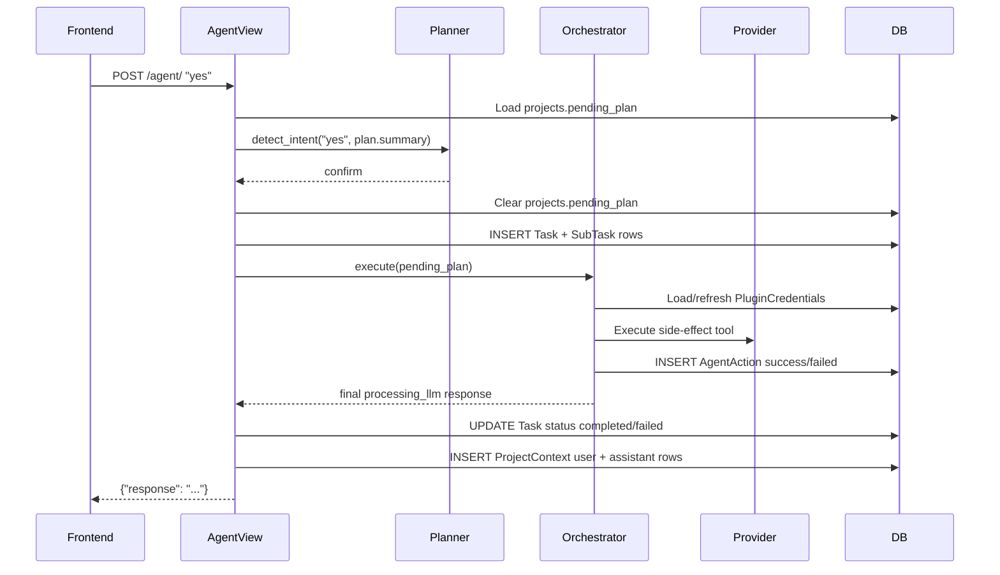

Files hit in order:

1. `agent/views.py`
   - `run_prompt(...)`
2. `agent/pending_plan.py`
   - `load(user_id, project_id)`
3. `planner/planner.py`
   - `detect_intent(prompt, pending.summary, user_id=user_id_str)`
4. `agent/views.py`
   - Confirms intent.
   - `_validate_plan_plugins(...)`
5. `agent/pending_plan.py`
   - `clear(user_id, project_id)`
   - `reset_modify_count(user_id, project_id)`
6. `orchestrator/orchestrator.py`
   - Executes plan steps.
7. `orchestrator/credentials.py`
   - Loads/refreshes credentials where needed.
8. Tool module
   - Executes provider action.
9. `orchestrator/orchestrator.py`
   - `_record_action(...)` for confirmation-required tool.
10. `agent/chat_context.py`
   - Persists confirmation message and final response.

Database and cache interactions:

| Component | Operation |
| --- | --- |
| `projects` | Read `pending_plan` |
| `planner_usage` | Insert usage row for `detect_intent` when OpenAI usage exists |
| `projects` | Clear `pending_plan` |
| Django cache | Delete `pending_modify_count:<user_id>:<project_id>` |
| `tasks` | Insert and finish an execution task when `project_id` is present |
| `sub_tasks` | Insert one subtask per pending-plan step when the task record is created |
| `PluginCredentials` | Select/update credential if the action needs OAuth |
| `agent_actions` | Insert success/failure row for confirmation-required tool |
| `project_context` | Insert confirmation and final assistant response |

End:

- Side effect has happened.
- `projects.pending_plan` is empty.
- `agent_actions` contains an audit record for the confirmed action.

### Step 7C: User cancels

If `detect_intent(...)` returns `cancel`:

1. `agent/pending_plan.py.clear(...)` sets `projects.pending_plan = None`.
2. `pending_plan.reset_modify_count(...)` clears the cache counter.
3. `agent/chat_context.py` stores user reply and assistant cancellation.
4. No orchestrator execution happens.
5. No provider API action happens.
6. No `AgentAction` row is created.

Response:

```json
{
  "response": "Got it - cancelled. What else can I help you with?"
}
```

### Step 7D: User modifies the plan

If `detect_intent(...)` returns `modify`:

1. `agent/views.py` checks `AGENT_MAX_MODIFY_REVISIONS`, default `5`.
2. Current count comes from Django cache key:

```text
pending_modify_count:<user_id>:<project_id>
```

3. `planner/planner.py.revise_plan(...)` asks OpenAI for a revised plan.
4. Revised plan is validated.
5. `agent/pending_plan.py.save(...)` replaces `projects.pending_plan`.
6. `pending_plan.increment_modify_count(...)` increments the cache count.
7. `agent/chat_context.py` stores user feedback and revised summary.

Database and cache interactions:

| Component | Operation |
| --- | --- |
| `projects` | Read and replace `pending_plan` |
| `planner_usage` | Insert usage row for `intent` and `revise` calls when OpenAI usage exists |
| Django cache | Read/increment modify count |
| `project_context` | Insert user feedback and revised assistant summary |

If the modify cap is hit:

- The pending plan is cleared.
- The modify count is reset.
- The user is asked to start a fresh request.

## Flow 8: Agent Dry Run

Dry run uses the same endpoint:

```json
{
  "prompt": "Send an email to Tyler saying the build is ready.",
  "project_id": 14,
  "dry_run": true
}
```

Behavior:

1. `agent/views.py` validates `dry_run`.
2. `run_prompt()` builds a fresh plan.
3. Even if the plan includes confirmation-required tools, `run_prompt()` does not save it as pending because `dry_run=True`.
4. `orchestrator/orchestrator.py` executes the plan.
5. For each `requires_confirmation=True` step:
   - The tool is skipped.
   - A placeholder object is stored in the execution context.
6. Final `processing_llm` still runs and explains what would have happened.
7. Response includes `"dry_run": true`.

Database interactions:

| Table/cache | Operation |
| --- | --- |
| `project_context` | Insert user prompt and dry-run assistant response |
| `PluginCredentials` | Read/refresh only for non-skipped credential tools that execute |
| `tasks` / `sub_tasks` | Not written during dry runs |
| `agent_actions` | No row for skipped dry-run actions |
| `projects.pending_plan` | Not used |

Response shape:

```json
{
  "response": "...",
  "dry_run": true
}
```

## Flow 9: Streaming Agent Prompt

`POST /agent/stream/` is the streaming variant of `/agent/`.

Differences from `/agent/`:

- It is an async Django view.
- It is `@csrf_exempt`.
- It manually authenticates using `SupabaseAuthentication`.
- It uses a cache-backed sliding-window throttle key: `throttle_agent_stream_<user.pk>`.
- It returns `text/event-stream`.
- It emits step-completion events through the `on_step` callback passed into `run_prompt()` and `execute()`.

Files hit in order:

1. `backend/urls.py`
   - `path('agent/stream/', agent_stream_view)`
2. `agent/views.py`
   - `agent_stream_view(...)`
   - `_auth_stream(...)`
   - `_is_stream_throttled(...)`
   - `event_generator()`
3. Same internal `run_prompt()` path as `/agent/`.
4. `orchestrator/orchestrator.py`
   - Calls `on_step(...)` after completed steps.
5. `agent/views.py`
   - Serializes SSE frames with `_sse(...)`.

SSE events:

| Event | Data |
| --- | --- |
| `status` | `{"message": "Planning..."}` |
| `step` | `{"step_id": "...", "tool": "...", "index": 0, "total": 2}` |
| `done` | `{"response": "...", "dry_run": false}` |
| `error` | `{"code": "...", "message": "..."}` |

## Flow 10: Saved Workflow Validation And Execution

Saved workflows persist a validated plan so it can be run again without asking the planner to re-plan from a prompt.

Key behavior:

- A saved workflow belongs to one local user.
- A saved workflow stores raw `Plan` JSON in `SavedWorkflow.plan`.
- `input_schema` is optional and defines runtime inputs available to plan params as `$input.<name>`.
- Running a saved workflow calls the orchestrator directly through `workflows/runner.py`; it does not call `planner.plan(...)`.
- Saved workflow execution does not create `Task` / `SubTask` rows.

### Step 10A: Validate a workflow without saving

```http
POST /workflows/validate/
Authorization: Bearer <token>
Content-Type: application/json

{
  "plan": {
    "summary": "Search Drive for a named file",
    "steps": [
      {
        "id": "step_1",
        "tool": "drive.search_files",
        "params": {"query": "$input.query"},
        "output_var": "files"
      }
    ],
    "final_output_var": "files"
  },
  "input_schema": [
    {"name": "query", "type": "string", "required": true}
  ]
}
```

Files hit:

1. `backend/urls.py`
2. `workflows/urls.py`
3. `workflows/views.py`
   - `workflow_validate_view(...)`
   - `_full_validate(...)`
4. `workflows/scheduling.py`
   - `validate_workflow_plan(...)`
   - `validate_plan_deep(...)`
   - `validate_input_schema(...)`
5. `tools/registry.py`
   - Verifies referenced tools exist.

Responses:

```json
{"valid": true, "errors": []}
```

or:

```json
{"valid": false, "errors": ["Step 'step_1': unknown tool 'bad.tool'"]}
```

### Step 10B: Save a workflow

```http
POST /workflows/
Authorization: Bearer <token>
Content-Type: application/json

{
  "name": "Find Drive file",
  "description": "Search Drive by user-provided query",
  "project_id": 14,
  "plan": { "...": "..." },
  "input_schema": [
    {"name": "query", "type": "string", "required": true}
  ]
}
```

Database interactions:

| Table | Operation |
| --- | --- |
| `Users` | Auth lookup/sync |
| `projects` | Optional ownership check when `project_id` is supplied |
| `saved_workflows` | Insert workflow row |

### Step 10C: Run a saved workflow

```http
POST /workflows/<workflow_id>/run/
Authorization: Bearer <token>
Content-Type: application/json

{
  "inputs": {
    "query": "invoice"
  }
}
```

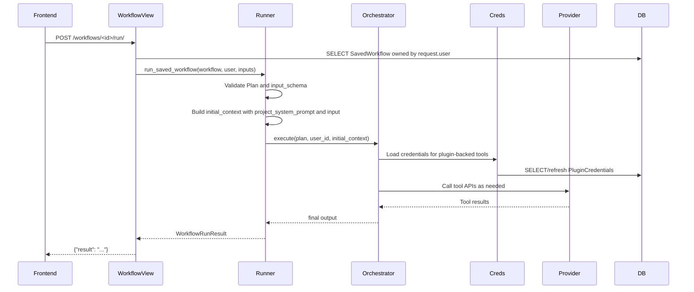

Failure responses:

| Failure | Response |
| --- | --- |
| Workflow missing or owned by another user | `404 {"error": "not_found"}` |
| Missing/invalid required inputs | `400 {"error": "invalid_inputs"}` |
| Required plugin not connected | `422 {"error": "plugin_not_connected", "plugin": "<plugin_id>"}` |
| Invalid saved plan or unknown tool | `500` or `400` depending on the validation failure |

## Flow 11: Scheduled Recurring Workflow Execution

Scheduled runs wrap a saved workflow with a cron expression and timezone. They are recurring schedules. A one-time immediate execution is available through `run-now`, but one-time future schedules are not a separate model in the current backend.

Runtime components:

- Django web process serves the REST API.
- Celery Beat runs `workflows.dispatch_due_scheduled_runs` every minute.
- Celery workers run `workflows.run_scheduled_run`.
- Redis is the Celery broker that carries queued task messages from Beat/web to workers.
- If `REDIS_URL` is set, Django cache also uses Redis. Without it, Django uses local memory cache, but Celery still needs a broker URL.

### Step 11A: Create a recurring schedule

```http
POST /scheduled-runs/
Authorization: Bearer <token>
Content-Type: application/json

{
  "workflow_id": 5,
  "name": "Daily Drive search",
  "cron": "0 7 * * *",
  "timezone": "America/Edmonton",
  "enabled": true
}
```

Files hit:

1. `backend/urls.py`
2. `workflows/urls.py`
3. `workflows/scheduled_views.py`
   - `scheduled_run_list_view(...)`
   - `_get_owned_workflow(...)`
   - `_validate_workflow_for_schedule(...)`
4. `workflows/scheduling.py`
   - `validate_workflow_schedulable(...)`
5. `workflows/models.py`
   - `compute_next_run_at(...)`
   - `validate_cron_expression(...)`
   - `validate_timezone_name(...)`

Database interactions:

| Table | Operation |
| --- | --- |
| `saved_workflows` | Select workflow owned by the user |
| `scheduled_runs` | Insert schedule with computed `next_run_at` |

Common cron examples:

| Cron | Meaning |
| --- | --- |
| `0 7 * * *` | Daily at 7:00 |
| `0 9 * * 1` | Weekly on Monday at 9:00 |
| `*/15 * * * *` | Every 15 minutes |
| `0 8 1 * *` | Monthly on the first day at 8:00 |

### Step 11B: Beat dispatches due schedules

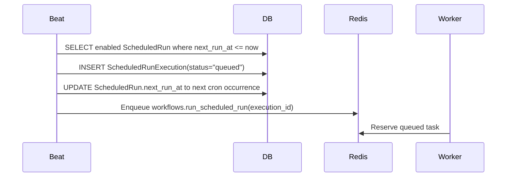

Files hit:

1. `backend/settings.py`
   - `CELERY_BEAT_SCHEDULE`
2. `backend/celery.py`
   - Creates the Celery app and autodiscovers tasks.
3. `workflows/tasks.py`
   - `dispatch_due_scheduled_runs(...)`

Database interactions:

| Table | Operation |
| --- | --- |
| `scheduled_runs` | Select enabled due rows and advance `next_run_at` |
| `scheduled_run_executions` | Insert queued execution rows |
| `scheduled_run_executions` | Store `celery_task_id` after enqueue when available |

If enqueue fails, the execution is marked `failed` with `queue_unavailable`, and the scheduled run's `last_status` / `last_error` are updated.

### Step 11C: Worker executes one scheduled workflow

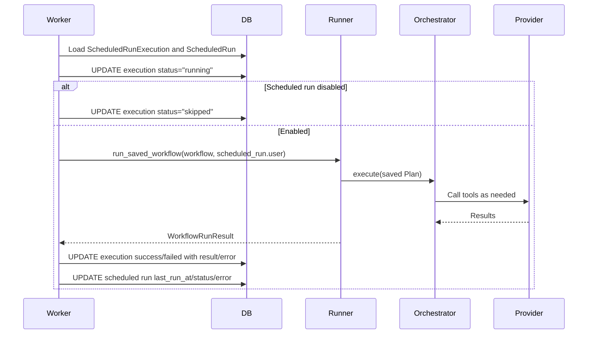

Files hit:

1. `workflows/tasks.py`
   - `run_scheduled_run(...)`
   - `execute_scheduled_run(...)`
2. `workflows/scheduling.py`
   - `validate_workflow_schedulable(...)`
3. `workflows/runner.py`
   - `run_saved_workflow(...)`
4. `orchestrator/orchestrator.py`
   - `execute(...)`

Database interactions:

| Table | Operation |
| --- | --- |
| `scheduled_run_executions` | Status transitions: `queued` -> `running` -> `success` / `failed` / `skipped` |
| `PluginCredentials` | Select/refresh credentials for plugin-backed tools |
| `scheduled_runs` | Update `last_run_at`, `last_status`, and `last_error` |

### Step 11D: Run now

`POST /scheduled-runs/<id>/run-now/` creates one queued `ScheduledRunExecution` immediately and enqueues the same Celery worker task. It does not change the schedule's cron pattern and does not replace future recurring runs.

## Data Storage Summary

| Data | Storage | Main writers |
| --- | --- | --- |
| Local users | `Users` | `authentication/authentication.py` |
| Projects and plugin gate | `projects` | `projects/views.py`, `agent/pending_plan.py`, `agent/chat_context.py` |
| Pending confirmation plan | `projects.pending_plan` | `agent/pending_plan.py` |
| Conversation transcript | `project_context` | `agent/chat_context.py`, `context/views.py` |
| OAuth one-time state and pending callback data | `PluginOAuthStates` | `plugins/views.py`, `plugins/services/credentials.py` |
| OAuth credentials | `PluginCredentials` | `plugins/views.py` finalize path, `plugins/services/credentials.py`, `orchestrator/credentials.py` |
| Planner token usage | `planner_usage` | `planner/planner.py` |
| Confirmed action audit log | `agent_actions` | `orchestrator/orchestrator.py` |
| Saved workflows | `saved_workflows` | `workflows/views.py`, `tools/workflows/api.py` |
| Scheduled workflow definitions | `scheduled_runs` | `workflows/scheduled_views.py`, `workflows/tasks.py` |
| Scheduled execution history | `scheduled_run_executions` | `workflows/scheduled_views.py`, `workflows/tasks.py` |
| Persistent user memory | `user_memories` | `agent/views.py`, `tools/memory/api.py` |
| Plan cache | Django cache | `planner/planner.py` |
| Pending-plan modify count | Django cache | `agent/pending_plan.py` |
| Stream throttle | Django cache | `agent/views.py` |
| Tasks CRUD and agent execution records | `tasks`, `sub_tasks` | `tasks/views.py`, `agent/views.py` |

## Tool Visibility And Credential Injection

Tool registration starts when Django loads the `tools` app and runs `ToolsConfig.ready()`.

Files involved:

1. `backend/settings.py`
   - Includes `tools.apps.ToolsConfig` in `INSTALLED_APPS`.
2. `tools/apps.py`
   - Discovers subpackages with `pkgutil.iter_modules`.
   - Imports every tool package.
3. Tool package `__init__.py`
   - Imports implementation file.
4. Tool implementation file
   - Calls `register(ToolDef(...))`.
5. `tools/registry.py`
   - Stores each `ToolDef` in `_REGISTRY`.

Planner visibility:

1. `agent/views.py` loads project.
2. `_get_enabled_plugins(project)` reads `project.plugins`.
3. `get_schemas_for_planner(enabled_plugins)` excludes plugin-backed tools whose `ToolDef.plugin_id` is not enabled.
4. Planner sees only the filtered schema list.

Credential injection:

1. Planner never includes tokens.
2. Plan step names a tool.
3. Orchestrator loads `ToolDef`.
4. If `requires_creds=True`, orchestrator calls:

```text
orchestrator.credentials.load_credentials(user_id, tool_def.plugin_id, step.account_id)
```

5. Token data is injected into tool params as `token_data`.

The key invariant for plugin-backed tools:

```text
PLUGIN_REGISTRY key == Credentials.plugin == projects.plugins key == ToolDef.plugin_id
```

## Current Tool Families

| Namespace | Example tools | Credentials | Confirmation |
| --- | --- | --- | --- |
| `processing_llm` | `processing_llm` | No | No |
| `weather` | `weather.get_current_weather`, `weather.get_weather_forecast`, `weather.get_weather_by_coordinates` | No | No |
| `contacts` | `contacts.search`, `contacts.create`, `contacts.update`, `contacts.delete` | No OAuth token; some use backend `user_id` | `contacts.delete` requires confirmation |
| `gmail` | `gmail.search_emails`, `gmail.get_unread_emails`, `gmail.send_email`, `gmail.trash_email`, `gmail.create_draft` | `gmail` | Send/trash/send draft require confirmation; several read/label/draft operations do not |
| `calendar` | `calendar.list_events`, `calendar.create_event`, `calendar.update_event`, `calendar.delete_event`, `calendar.get_free_busy`, `calendar.list_calendars` | `google_calendar` | Create/update/delete require confirmation |
| `drive` | `drive.list_files`, `drive.search_files`, `drive.get_file_metadata`, `drive.read_file` | `google_drive` | No |
| `google_contacts` | `google_contacts.list`, `google_contacts.search`, `google_contacts.sync` | `google_contacts` | No |
| `outlook` | `outlook.get_unread_emails`, `outlook.get_emails`, `outlook.search_emails`, `outlook.send_email`, `outlook.reply_email` | `outlook` | Send/reply require confirmation |
| `outlook_calendar` | `outlook_calendar.list_events`, `outlook_calendar.create_event`, `outlook_calendar.update_event`, `outlook_calendar.delete_event`, `outlook_calendar.get_free_busy` | `outlook_calendar` | Create/update/delete require confirmation |
| `web` | `web.search` | No | No |
| `workflow` | `workflow.save`, `workflow.list` | No | No |
| `memory` | `memory.save`, `memory.delete` | No OAuth token; uses backend `user_id` | No |

## Error Flow Summary

| Failure point | Code path | Result |
| --- | --- | --- |
| Missing/invalid bearer token | `authentication/authentication.py` | Auth error before target view work |
| Bad `/agent/` body | `AgentRequestSerializer` | `400 {"error": {"code": "bad_request"}}` |
| Unknown or foreign `project_id` | `get_object_or_404(Projects, pk=project_id, user=request.user)` | `404` |
| Planner references unregistered tool | `_validate_plan_tools` or `execute()` | `400 unknown_tool` |
| Planner uses disabled plugin tool | `_validate_plan_plugins` | `400 unknown_tool` with disabled plugin detail logged/raised |
| Required plugin not connected | `orchestrator.credentials.load_credentials` | `422 plugin_not_connected` |
| Provider/tool failure | `orchestrator.orchestrator.execute` | `500 tool_execution_failed` |
| OAuth callback failure | `OAuthCallbackView.get` | `302` to failure deep link |
| OAuth finalize token missing/mismatched/expired | `OAuthFinalizeView.post` | `400` / `403` error response, no credential write |
| Saved workflow input validation failure | `workflow_run_view` / `run_saved_workflow` | `400 invalid_inputs` |
| Scheduled run queue unavailable | `scheduled_run_now_view` or dispatcher task | Execution marked failed; API returns `503 queue_unavailable` for run-now |

## High-Level Agent Branch Map

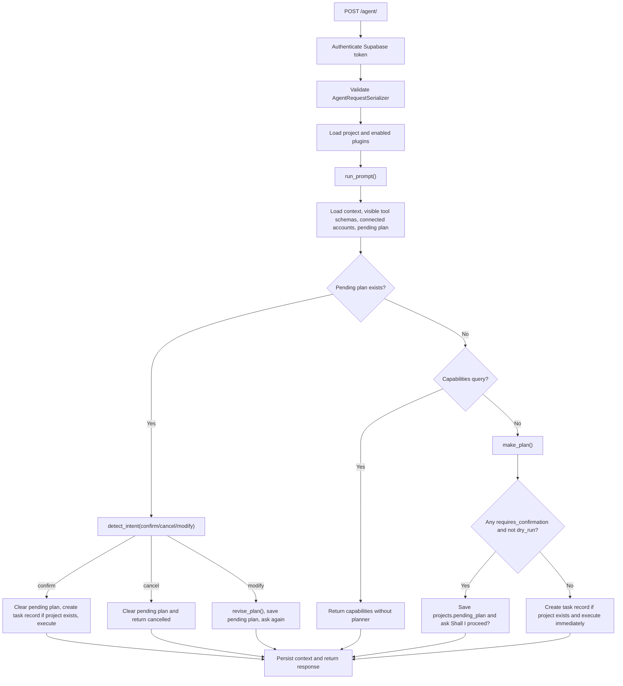
