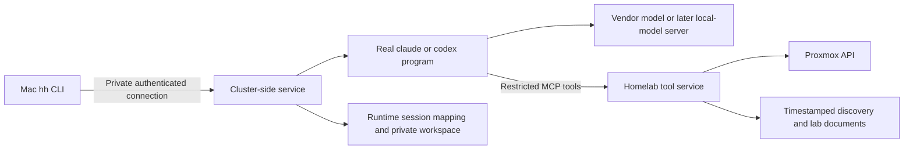

# CLI-first Homelab Harness: revised direction and next steps

> **Status: proposed implementation plan, 2026-11-20.** Incorporates the maintainer's latest clarification: wrap the actual, unmodified `claude` or `codex` program on the service host; do not build our own model/tool loop. This supersedes the loop-ownership recommendation in the [earlier alignment review](../reviews/2026-11-20-vision-alignment.md). It is not a claim that the new terminal experience is implemented, or a replacement for the binding spec until the reconciliation below lands.

## 1. Product and ownership

**A Proxmox-focused agent workspace and supervisor: a thin Mac CLI connects to a service guest in the cluster, which runs an existing agent runtime with homelab-specific tools, context and permissions.**

Stage 1 has one owner, one cluster per service instance, one agent and one active run. The agent runtime lives on the service guest. The Mac remembers saved service connections and its own client authentication, not the lab's authoritative memory, target credentials or runtime sessions. A later GUI can use the same service API. Multiple roles, jobs and supervised agents are later features, not first-stage scaffolding to implement now.

The chosen subscription integration is **launching the vendor's real CLI**. Homelab Harness does not implement the vendor's OAuth protocol, read its credential cache, impersonate its client, or send subscription tokens to inference endpoints itself. The vendor runtime performs its supported login, model calls and refresh. Supported setup may involve an owner completing a browser/device flow from their Mac, while the runtime's resulting state stays on the service guest.

## 2. Model, runtime, agent and harness are different things

| Term | Meaning here |
|---|---|
| Model | Generates responses and proposed tool calls. It does not itself run Python functions, inspect Proxmox or provide a complete session manager. |
| Model server/provider | Hosts inference: a vendor service, LM Studio, Ollama or a VPS endpoint. Endpoint compatibility does not imply equivalent tool reliability or context support. |
| Agent runtime | Drives the repeated model/tool conversation and handles its conversation state, tool-call protocol and runtime-specific compaction. Initially the actual Claude Code or Codex program. |
| Agent | A running session with a runtime, model, instructions, workspace and allowed tools. A later role is configuration on such an agent, not necessarily another model. |
| Homelab Harness | The product around these runtimes: connection experience, session lifecycle, lab context, tool service, deterministic authorization, credentials, audit and later supervision/GUI. |

This is a specialized harness/supervisor around an existing agent runtime. The runtime is also a harness in the broader sense used by the article. There is no requirement to invent a custom loop merely to call our product a harness.

## 3. A local model still needs something to drive tool use

With a raw LM Studio-compatible chat endpoint, application code must execute proposed tool calls and send results back. Therefore a bare model server is not interchangeable with Claude Code as a complete agent runtime. Source: [LM Studio tool-use flow](https://lmstudio.ai/docs/developer/openai-compat/tools).

That does not require **our** code to own the loop. Codex documents local-provider support for LM Studio and Ollama, so a later local-model option can reuse that runtime. Test the selected model/runtime/tool combination before claiming support. A VPS's compatible endpoint is another inference location, not automatically a runtime. Sources: [Codex CLI local-provider options](https://learn.chatgpt.com/docs/cli/reference), [provider configuration](https://learn.chatgpt.com/docs/config-file/config-advanced).

LM Studio also documents native MCP integrations through its chat API. That is a separate possible orchestration surface; it should not be confused with raw chat completions or assumed to have identical session/control behavior. Source: [LM Studio MCP API](https://lmstudio.ai/docs/developer/core/mcp).

Initial support remains one subscription-backed runtime. Local models are future work. If inference later runs on the Mac, suspending the Mac can make inference unavailable even though the agent workspace remains on the cluster. Running the model on another lab guest or a VPS avoids that particular dependency.

## 4. Management commands and interactive chat both belong in the CLI

The earlier comparison was about what the existing CLI implements, not a proposal to remove management commands.

Current commands include `hh health`, `hh version`, `hh secret`, `hh vault` and `hh clients`. They configure or inspect the current control-plane service; they do not provide a conversational agent session.

The new CLI should eventually have both:

- **Management:** add/select/remove a saved service connection, pair with a service, check health, guide runtime login, connect Proxmox, perform discovery, inspect sessions and troubleshoot configuration.
- **Interaction:** select a cluster/service, enter a conversation, view progress/results, interrupt a run and reconnect to saved history.

“External client setup” in the old docs means configuring the owner's separate workstation application to reach the MCP server: for example adding our MCP URL to Claude Code or Codex on the Mac. In the revised experience, the service configures its managed runtime's tool connection. The owner enters through `hh`; they need not manually wire up another desktop client for ordinary use. The runtime is external software, but its installation/configuration is managed on the service guest.

Do not build every management command before the first task. A short manual setup procedure is acceptable initially, followed by the smallest commands that remove real setup friction.

## 5. The two model-connection approaches

| Approach | Who contacts the model and drives tools? | Who manages provider authentication? | Decision |
|---|---|---|---|
| Direct provider connection | Our code would call the model, interpret tool requests, dispatch tools and continue the loop | Our provider integration | Not the initial architecture. The previous direct-subscription proof is no longer required. |
| Official-runtime wrapper | The real `claude` or `codex` program, launched by the service | The runtime's supported login flow and protected credential storage | Chosen approach. We manage the session around it and provide domain tools. |

Subscription login, runtime selection and model selection are distinct. For example: the backend can be Codex, the provider can be the owner's ChatGPT account, and the selected model must be one that runtime/account actually exposes. A later backend may use Codex with a local model instead. Do not promise every model works with every runtime.

Claude Code documents programmatic use of the CLI with structured/streamed responses, session continuation and custom instructions. Anthropic permits use of the unmodified binary under stated conditions, including each owner's own authentication; it does not give arbitrary subscription proxies blanket permission. Sources: [programmatic CLI](https://code.claude.com/docs/en/headless), [legal/authentication conditions](https://code.claude.com/docs/en/legal-and-compliance).

Codex App Server is a mode of the actual Codex program for custom clients, with authentication, threads, approvals and streamed events. It is a candidate for the later Codex adapter, not our own inference loop. Prefer these documented programmatic surfaces over scraping an interactive terminal's screen. Sources: [App Server](https://learn.chatgpt.com/docs/app-server), [Codex authentication](https://learn.chatgpt.com/docs/auth).

## 6. What our wrapper owns, and what it delegates

| Responsibility | Owner |
|---|---|
| Model-call/tool-call iteration, conversation history and runtime compaction | Existing runtime |
| Launch, stream, resume, interrupt and bound the session | Wrapper through the runtime's supported interface |
| Select relevant lab facts, render compact context, provide operator instructions and role configuration | Wrapper/tool service |
| Validate tool inputs, restrict targets, enforce read-only access and protect target credentials | Tool service and Proxmox ACLs |
| Saved service connections and terminal presentation | Mac CLI |
| Durable lab observations, owner notes and workspace | Cluster-side service |
| Future model-free action previews, approvals and execution checks | Domain core, independent of runtime |

“Proper context management” is shared ownership: the runtime manages the conversation window; we provide bounded, relevant, fresh lab context. We should not implement a competing conversation compactor or duplicate the entire runtime transcript in a second authoritative store. Initially record runtime/session identifiers and wrapper metadata; retain native runtime history on a persistent service-owned volume. Lab notes and discovery snapshots have separate ownership and freshness rules.

Instruction customization varies by runtime. Use supported instructions/configuration surfaces and test them. Do not promise complete replacement of every runtime's built-in system prompt or identical behavior across backends.

The runtime's built-in shell/filesystem tools must not provide a way around the homelab tool boundary. Keep Proxmox credentials outside its readable workspace, expose only the required MCP tools, and verify effective restrictions with the selected runtime. A “read-only” label or prompt is insufficient. If the runtime cannot be safely restricted for this milestone, stop and report the limitation before granting real lab credentials.

## 7. Preserve the current implementation before restarting

The current `main` at `a97f2aa` is preserved on `archive/pre-cli-restart-2026-11-20`. The existing v0 archive remains untouched. The analysis and this plan live on the separate `docs/vision-alignment-review` branch.

Do not reset/force-push `main`, delete current runtime code or discard databases during this planning step. After the documentation boundary is agreed, create a new implementation branch and make the minimal runnable baseline a reviewable change. Preserve history and describe intentionally retired functionality. Do not restore v0 code.

Starting from first principles means selecting each piece for an immediate requirement. It does not require rewriting proven TLS verification, redaction or Proxmox parsing. Review those pieces as reuse candidates; do not bulk-copy the old full platform into the new baseline.

## 8. What to do next, in order

### Step 0: reconcile the docs before building

1. Revise vision, architecture, glossary and AGENTS.md around a managed cluster-side runtime and thin Mac client.
2. Supersede ADR-0003's **workstation/external-client entry point**, while retaining its no-custom-model-loop and no-subscription-proxy principles. Explain that the first-party runtime now runs under our service. Reassess UI-in-v1 timing without erasing the existing UI's implementation history.
3. Replace clients/onboarding with service pairing, managed runtime login, read-only Proxmox setup and saved instance selection.
4. Replace the broad roadmap with the increments below. Keep GUI, additional backends, roles/jobs and other capabilities as short future intentions.
5. Preserve S1–S10, protected secrets, typed tools, provenance and honest outcomes. Describe the owned layers from the article without recreating the runtime's layers.
6. Update status/getting-started to distinguish current code from the planned CLI. Do not relabel the future experience as implemented.

No need for a complete future supervisor design, a frontend framework decision or a generic plugin framework during this step.

### Stage 1: one subscription-backed agent and read-only discovery

Proposed first backend: **Claude Code**, because the maintainer specifically chose the unmodified-CLI subscription route. This is an implementation-order recommendation, not a requirement to exclude Codex. Build one concrete backend integration first; add the second only after the first has been used on the lab. Do not design a large multi-runtime abstraction up front.

| Increment | Smallest deliverable | Required verification |
|---|---|---|
| 1A: runtime proof | On a manually created service guest, launch the real CLI with its supported subscription login, a fixed homelab instruction and one harmless fixture tool. Stream a final answer. | Confirm subscription access, supported instruction loading, tool invocation, error reporting, interruption and session continuation. Prove built-in tool restrictions and credential boundaries before connecting Proxmox. |
| 1B: deterministic discovery | A small typed Proxmox tool set for cluster/node identity, VM/LXC inventory, node CPU/memory and per-node storage usage. Save source/timestamp information. | Compare real results with Proxmox. Verify TLS and the read token. Test permission denial/unreachable-source behavior with fixtures or a dedicated test credential; never interrupt a production node to test an outage. |
| 1C: thin Mac CLI | Add/select a saved harness instance, establish one authenticated encrypted connection, submit a message and show runtime progress/results. | Connect from the Mac to the service guest; verify server/cluster identity and reject revoked access. Keep provider and Proxmox credentials off the client. |
| 1D: end-to-end discovery chat | The managed runtime uses the real read tools to answer the agreed questions. Context comes from bounded tool results and lab documents. | Ask about running LXCs, guest placement, node memory/CPU and storage usage. Compare answers against Proxmox; refuse VM creation and generic commands. Test malicious fixture text and output limits. |
| 1E: persistence and repeatability | Service-owned runtime/session mapping, native history, owner notes and discovery snapshots; reconnect and explicit stale/interrupted states. | Restart the service, reconnect from a clean CLI and verify history remains. Refresh after a harmless real state change already made by the owner. Record limitations; no silent background continuation or replay. |

The first deployment needs a service guest, one vendor runtime and a protected workspace/tool service. Evaluate whether the existing vault/audit persistence is worth retaining in that minimal composition. Do not make full Grafana, a public MCP authorization server, phone approvals, collectors, UI assets or DBOS a dependency just because they exist in today's code.

Use the simplest supported private transport. An SSH-forwarded service endpoint is a first candidate; HTTPS with explicit trust is another. Pick one after the runtime proof, rather than implementing both. No public internet-facing service is required; subscription inference still needs the vendor's normal outbound connectivity.

Initial memory consists of owner-managed notes plus code-generated facts. The agent cannot turn arbitrary target text into trusted instructions or overwrite discovery facts. Use live reads/freshness checks for volatile information. Memory and transcripts contain private lab information and must not be exported to Git or ordinary logs automatically.

Every increment gets automated fixture/failure tests and a short manual acceptance record. There is no advance to the next increment until the owner has tried the current deliverable and failures have been resolved or explicitly accepted. Keep tests against the owner's lab out of the default automated suite.

Stage 1 is done when the Mac can connect to its chosen instance, start/resume one subscription-backed runtime session and get correct, sourced discovery answers, with bounded execution and durable server-side state. It cannot create or change guests, execute generated tools, supervise several agents or show a GUI.

### Later stages, only when the preceding result is useful

| Stage | Scope | Acceptance boundary |
|---|---|---|
| 2: one useful improvement | Choose a measured need: capacity checks, smoother setup, richer compact context or a second runtime. Do not bundle them. | One real task improves without losing correctness, permissions or reconnect behavior. |
| 3: one controlled write | Create a VM from a known template on a disposable scope, with immutable preview, explicit owner approval, re-preflight, durable execution and verification. | Fault tests plus owner acceptance on a disposable guest; no automatic approval initially. |
| 4: reusable extensions | Add another operation by composing proven steps. Agent-authored tools remain drafts until reviewed, tested and installed. | The extension uses the same policy/approval path; unreviewed code never runs against the lab. |
| GUI later | Start with one cluster-hosted view or conversation surface over the same service API, then demonstrate one reusable widget. | Shared facts and policy across CLI/GUI, with no frontend-owned business rules. It can be scheduled independently once the core is stable. |
| Supervision later | Named roles, jobs, several sessions/runtimes and a visual management surface. | Explicit authority per role, concurrency/budgets, isolation, job ownership and recovery proven for each new workflow. |
| Additional inference later | Local LM Studio/Ollama or a VPS through an existing compatible runtime. | Verify the exact model's tool use, context and permission behavior; hosting location alone is not acceptance. |

## 9. Remaining decisions and checks

- Try the proposed Claude Code backend first; if a documented control surface cannot provide the required restrictions, assess Codex before adding complexity. Do not secretly build a custom loop as a fallback.
- Choose one supported service-guest installation and private connection method. The maintainer already accepted manual guest creation; automatic installation is deferred.
- Confirm initial disconnect behavior. Recommended: interrupt the read-only run, retain history and require an owner request to continue. Do not assume vendor process exit means every spawned child or tool has stopped; verify cancellation propagation and bound tool calls independently.
- Decide how existing data/components are retired before deleting code or changing storage. Archive preservation is complete; implementation reset has not started.
- The GUI's eventual host node, multiple-agent role taxonomy, dynamic tool authoring and full provider matrix do not block Stage 1.

## 10. Validation and limits

This is documentation/planning work. No runtime integration, model login, infrastructure setup, database reset or code deletion was performed. Current `main` remains at `a97f2aa`. The unchanged implementation's previously recorded baseline is 704 Python tests passing, Ruff clean and Pyright at 0 errors. New documentation links and the preservation branch are verified before publishing this revision; no new end-to-end support is claimed.
