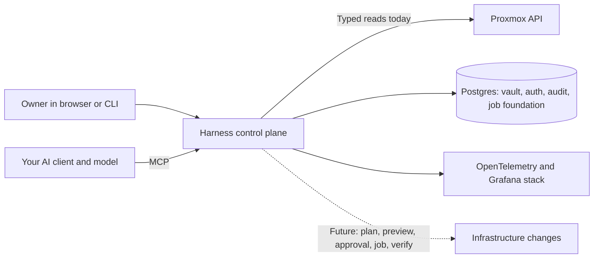

# What homelab-harness does today, and where it is going

Status reviewed on **2026-11-20**. The Python service and read-only browser foundation are implemented; connecting them to a real lab is the next acceptance test. “Implemented” below means code with automated tests, not verified behavior on your Proxmox cluster.

## The intended product

The goal is **one control plane for you and your AI clients to inspect and operate your existing homelab**. You open its web UI for daily work, or ask Claude Code, Codex or another MCP client a question. Both interfaces use the same typed data and, eventually, the same change workflow.

The harness runs no language model. Your AI client supplies the model; the harness supplies reliable facts, reusable operations, credentials, audit records and the rules governing changes. It is a single-owner system hosted on your own infrastructure, initially accessible over your tailnet.

The reason to build this instead of using a model with a root shell is repeatability: the model should not need to rediscover your lab or improvise a command every time. The target is fewer tokens and fewer mistakes, with a preview you can verify and a clear record of what happened. Token savings remain a goal to measure, not a published result.

## What is built

| Part | Functionality now | What it gives you | Current limit |
| --- | --- | --- | --- |
| **Core service** | Python 3.13, FastAPI, typed settings, `/healthz`, `/readyz`, structured logging and redaction. | One service with explicit health/configuration rather than separate agents on every node. | It needs a configured database, vault and target before useful real-lab reads work; a green liveness endpoint alone is insufficient. |
| **Capability SDK** | Shared typed errors, read-tool declarations, risk/retry vocabulary, package discovery and a contract test kit. | Proxmox is an installable capability; future domains can follow the same boundary. | The SDK does not itself implement the later plan/approval engine. |
| **Database and audit** | Postgres 17, SQLAlchemy, Alembic migrations and append-only audit events. | Persistent identity, credentials and an accountable record of tool/API activity. | An audit log records actions; it is not yet the synchronized model of the entire lab. |
| **Durable-job foundation** | DBOS lifecycle, system schema, readiness and recovery tests. | The foundation for jobs that survive process restarts. | There are no real infrastructure-change recipes to apply yet; runtime recovery tests do not establish safe recovery of arbitrary future writes. |
| **Proxmox capability** | 18 typed read tools, timeouts, mapped errors, TLS certificate pinning or CA verification, output masking, fixtures and bootstrap-script generation. | Read your existing nodes, guests, storage, disks, network, backups and task history through one API. | No guest creation, power actions, deletion, storage/network changes or general shell execution. Live reads currently use the first configured endpoint. |
| **MCP server** | Streamable HTTP at `/mcp`, capability-discovered tools, structured results, authentication and an audit record per call. | An AI client can ask about real cluster state without receiving the Proxmox credential. | It exposes the current read tools, not the future `lab://` documents, catalog or plan tools. Live client login is unverified. |
| **Secret vault** | Encrypted Postgres storage, versioning, add/show-metadata/list/rotate/revoke/delete, SSH-key generation, KEK providers and rewrap. Targets can resolve `secret://` handles at startup. | Keep Proxmox tokens and other credentials out of chat and source control. | Agent grants, general-purpose credential injection, reveal, imports and the secret-intake UI remain planned. Keep the encryption key backup separate from the database. |
| **Owner authentication** | Single-owner passkey enrollment, recovery codes, OAuth authorization/consent, rotating access/refresh tokens and client revocation. | Your MCP clients get individual, revocable access rather than sharing one universal credential. | A real browser/passkey and real Claude/Codex OAuth round trip still need verification. Owner CLI/dashboard tokens are separate from MCP tokens. |
| **CLI (`hh`)** | `version`, `health`, `secret`, `vault` and `clients` command groups. Host-only enrollment/token/migration commands are separate entry points. | Manage credentials and client access without a finished admin UI. | `hh init`, `hh doctor`, `hh lab`, recipes and approval commands are not implemented. |
| **Web UI foundation** | Datacenter → nodes → guests/storage tree; Summary pages; search/command palette; light/dark theme; five reusable widget templates; typed API client; static build served by FastAPI. | Browse your cluster through the same capability reads the MCP tools use. | The Tasks tab is a placeholder. No working action buttons, live updates, logs tab, terminal or AI assistant panel. It currently asks for an owner bearer token even if passkey login is enabled. |
| **Observability** | OpenTelemetry instrumentation plus optional Collector, Prometheus, Tempo, Loki and Grafana deployment and an overview dashboard. | Inspect service latency/errors, database pool, readiness, traces and harness logs. | This is not yet centralized collection of every node's journal, guest logs or Proxmox task history. Future plan/job/usage dashboards need their corresponding features. |
| **Delivery and tests** | uv/pnpm locks, Python lint/types/tests, browser lint/types/tests, Playwright, security scans, Compose, image and release workflows. | Reproducible local verification and a hardened non-root/read-only runtime container. | GitHub Actions jobs were blocked by an account billing issue when reviewed; this must be restored separately from fixing application code. |

### The 18 Proxmox read tools

| Area | Tools |
| --- | --- |
| Cluster | `proxmox.cluster.list`, `proxmox.cluster.resources` |
| Nodes | `proxmox.node.list`, `proxmox.node.get`, `proxmox.metrics.rrd` |
| Guests | `proxmox.guest.list`, `proxmox.guest.get` for QEMU VMs and LXCs |
| Storage | `proxmox.storage.list`, `proxmox.storage.status`, `proxmox.storage.content` |
| Disks | `proxmox.disk.list`, `proxmox.disk.smart` |
| Network and pools | `proxmox.network.list`, `proxmox.pool.list` |
| HA and backups | `proxmox.ha.status`, `proxmox.backup.jobs` |
| Tasks | `proxmox.task.list`, `proxmox.task.get` |

Examples to try once connected: “List my nodes and their current load”, “Which VMs and LXCs are running?”, “Show storage above 80% usage”, and “Show failed Proxmox tasks from the last day.” Some reads, such as SMART or detailed node data, may need privileges beyond a baseline read token; a permission error must remain an honest error, not a reason to silently escalate credentials.

## The eventual workflow

For reads, ask your client or browse the UI. Future deterministic sync will maintain **lab state**, and compact `lab://` documents will answer most questions without repeatedly contacting nodes for discovery. Facts will carry their source and age.

For changes, ask for an outcome such as “Create a 4-core, 8-GB VM from this template.” A reusable **recipe** will resolve your lab's storage, network and naming conventions, validate parameters, and create a stored **plan**. The plan will show what changes, preflight checks, exact calls, risk and rollback. Policy decides whether it needs approval. A durable job then rechecks live state, applies the change and verifies the result.

| Risk | Intended rule, not implemented change behavior today |
| --- | --- |
| T0: read | Read immediately. |
| T1: reversible, in the harness-managed scope | May auto-approve when owner policy permits; notify afterward. |
| T2: meaningful recoverable change | Owner approval through an authenticated owner channel. |
| T3: destructive, lockout or public exposure | Owner approval plus typed target confirmation and stricter preflight. |

The AI cannot approve its own plan, lower a risk floor or read a secret value. A request whose write may have happened must end as **uncertain**, rather than retrying blindly. These are binding design requirements for later stages; today the main protection is that target-change tools are absent.

The same recipe should eventually power an AI request and a UI button. Shared widget templates and data sources should make a request like “Add storage health to my top bar” a small configuration change rather than another bespoke component.

## What remains, in order

1. **Verify Stage 1 on the real lab.** Confirm passkey enrollment, MCP client login, real read results, vault persistence, UI data and telemetry. Resolve observed failures before expanding the scope.
2. **Stage 2: lab state, logs, onboarding and dashboards.** Sync/entities, budgeted lab documents, catalog/data sources, `hh init`, centralized log reads, useful widgets and live UI updates.
3. **Stage 3: safe operations.** Plans, policy, phone approvals, durable apply/verify jobs, guest recipes, UI actions and the assistant panel.
4. **Stage 4: broader operations.** Host/storage/ZFS/network recipes, Linux and Docker capabilities, and recorded terminals/consoles.
5. **Stage 5: steering and measurement.** Client skills/runbooks/resources, injection and reliability evals, and measured token efficiency against a plain-agent baseline.
6. **Stage 6: ecosystem and release.** Cloudflare, Obsidian notes/tasks/reminders, client usage, remaining pages, public MCP access with protection, and a v1 release backed by real daily use.

Cloudflare, Docker, Linux, Obsidian, full Proxmox-UI replacement, phone approvals, and an always-current lab model are **vision, not current capability**. The former Gmail/interview/SMS assistant is archived under `v0-django-final`; it is not the current product backlog.

## Testing it, step by step

The 2026-11-20 local verification passed **704 Python tests, 58 UI unit tests and 6 browser tests**, plus lint, formatting, strict types, generated API checks, the image build and dependency vulnerability scans. A disposable local Compose deployment also verified migrations, database/DBOS readiness, the development vault, owner/MCP token separation, client revocation and secret metadata surviving a harness restart. Its deliberately configured development environment-key provider reports `degraded`; this is expected and is not a production vault configuration. These checks used no real Proxmox target, passkey device or external MCP client.

Use [getting-started.md](getting-started.md) for exact commands. Proceed in this order, stopping at a failed checkpoint:

1. **Local checks, no lab:** install locked dependencies, run the full Python suite with Docker, UI checks/build, generated-types check and browser smoke. Expected: no skipped DB tests, no broken documentation links, no browser/CSP errors.
2. **Inspect the local UI:** run the built frontend through FastAPI. Without credentials, expect an owner-token prompt; the fixture browser tests supply example data separately.
3. **Start a disposable complete stack:** configure a new local test database and KEK, apply migrations through Compose, and inspect the body of `/readyz`. Expected: database/DBOS/vault present, with no claim that a Proxmox target is connected yet. The env KEK provider is dev/test-only and deliberately reports degraded; use a secure file for the real deployment.
4. **Enroll owner and test access boundaries:** use a stable HTTPS origin, enroll a passkey, save recovery codes offline, and create a separate owner token for `hh`/UI. Confirm MCP tokens cannot manage the vault and owner tokens cannot authenticate to `/mcp`.
5. **Connect one real cluster read-only:** reuse or deliberately create a read token, verify TLS, place its value in the vault through the hidden CLI prompt, and register its handle. Bootstrap changes permissions/tokens and requires a separate review; no existing guest needs changing.
6. **Check actual read correctness:** compare MCP answers and UI summaries with Proxmox for nodes, a VM, an LXC and storage. Check timestamps, units and masking; record permission failures rather than widening access indiscriminately.
7. **Verify client and trace behavior:** authenticate your actual MCP client, run a read, find the audit event and Grafana trace, then revoke a dedicated test client and verify it loses access.
8. **Check persistence and cleanup:** restart only the disposable harness service, confirm its vault and client records survive, then use normal Compose `down` to preserve volumes. Never recreate an existing KEK or use `down -v` on a deployment whose data you intend to keep.

First success is an authenticated, auditable read of your actual lab through both interfaces. It is not provisioning or operating a guest; those tests belong to the plan/approval stages.

## Understanding check

Your understanding matches the design if you expect **your existing AI client to reason, the harness to supply facts and enforce rules, and your UI and AI to share the same operations**. Today you can validate the read path and the supporting security/storage/telemetry foundation. The next major build is the maintained lab model; safe changes follow it.

Source of truth for the target behavior: [vision](spec/vision.md), [architecture](spec/architecture.md), [safety model](spec/safety-model.md), [secrets](spec/secrets.md), [UI](spec/ui.md), and the [roadmap](roadmap.md). The detailed specifications include future behavior; use the implementation table above when deciding what to try now.
