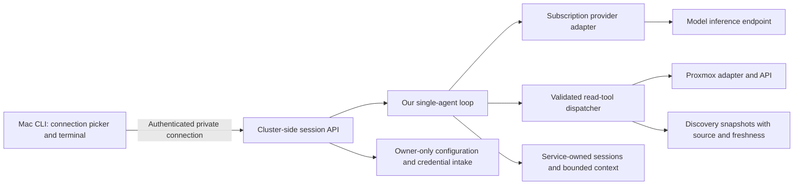

# Vision alignment review and proposed development stages

Reviewed on 2026-11-20 against `main` / `origin/main` at `a97f2aa`. Both refs matched after fetching. Scope: the 48 active tracked Markdown documents, with the nine v0 documents treated as historical reference. The supplied harness-architecture article and the maintainer's subsequent clarifications define the comparison. This is a findings document and a proposal, not a replacement specification or an implementation claim.

## 1. The product the maintainer now wants

**Homelab Harness is the owner's own extensible agent harness for operating a Proxmox homelab. One cluster-hosted service owns the agent loop, model connection, tools, sessions and memory. A thin Mac CLI connects to that service.**

Confirmed requirements:

- Begin with one owner, one agent and one active run. Supervising multiple agents is not an initial requirement.
- The harness owns its loop. Do not make Claude Code, Codex, their agent runtimes, or workstation bridges the implementation of that loop. Ordinary provider SDKs and maintained security libraries are compatible with owning the loop.
- An existing Claude or ChatGPT subscription is required for the initial model connection. A separate paid API account or local-only model is not an acceptable substitute for that milestone.
- Manually creating the service VM/container and following a short install guide is acceptable initially. Automatic guest creation and installation come later.
- The agent runtime, provider configuration and operational state live on that service guest. Model inference may run elsewhere; the location of inference is different from ownership of the agent loop.
- The Mac remembers connection profiles so the owner can select a previously connected cluster. It does not own the cluster's agent, memory or Proxmox credentials.
- Begin on the local network. No public endpoint, Cloudflare or mandatory tailnet service is required for Stage 1. Outbound access to a cloud model provider is a separate requirement.
- First useful behavior: discover the existing cluster and answer questions about nodes, running LXCs/VMs, memory, CPUs and storage using dedicated tools.
- Later: approved operations such as creating a VM; reusable tools and recipes; controlled agent-authored extensions; additional model backends including LM Studio or a VPS.
- Eventually: a GUI hosted in the cluster, potentially on another guest/node, with reusable widgets and extensions over the same core.
- Every small increment must be tested on the owner's lab before starting the next. Passing mocked tests alone does not close a milestone.

“Cluster selection” should initially mean selecting a saved **harness instance**, not selecting a Proxmox API endpoint for the Mac to operate directly. One instance owns one cluster. Supporting several saved connections does not require federation, cross-cluster plans or simultaneous agents.

## 2. Overall conclusion

The existing documents describe an **MCP-first control plane for external AI clients**, with a broad Proxmox UI replacement scheduled early. That differs from the newly clarified **CLI-first, cluster-hosted agent harness**. This is a product and architecture change, not a missing chat command.

Preserve the good boundaries: typed domain tools, adapters separated from policy, secret values excluded from model context, explicit authorization, untrusted target text, and verified outcomes. Reopen the assumptions about who owns the model loop, what must run in the first deployment, and when a feature is considered complete.

Do not equate “outside Stage 1” with “dead code.” The current UI, OAuth provider and DBOS foundation have consumers and tests. Their omission from a new minimal runtime requires an explicit composition or retirement decision, not an unsupported unused-code deletion.

## 3. Findings, in priority order

### F1. The binding architecture puts the agent in the wrong place

Evidence: [ADR-0003](../adr/0003-mcp-first-bring-your-own-ai.md), [vision](../spec/vision.md), [architecture](../spec/architecture.md), [clients](../spec/clients.md), [glossary](../../GLOSSARY.md), and [AGENTS.md](../../AGENTS.md) explicitly put reasoning in external clients and say the harness runs no model loop. ADR-0003 rejects an embedded loop.

Change: supersede ADR-0003 with a new decision for one cluster-side loop, a provider adapter, a shared domain-tool registry and a thin interactive CLI. Distinguish calling a model from hosting its weights. An optional external MCP interface can be reconsidered later; it must not define the first user experience.

If unchanged: following the current docs correctly builds the wrong product.

### F2. Subscription access is the first architecture gate

Evidence: [ADR-0003](../adr/0003-mcp-first-bring-your-own-ai.md) and [clients](../spec/clients.md) assume subscription use requires external vendor clients. Current primary documentation describes an additional OpenAI path, below.

Change: prove one documented subscription-backed inference and tool round trip from our own loop before designing the rest of the runtime. Recommend ChatGPT as the first candidate. “Claude or ChatGPT” permits starting with one; it does not require both at once. Do not silently substitute an API key, a vendor harness, extracted client credentials or a private vendor endpoint.

If unchanged: an apparently complete CLI could fail the maintainer's required way of paying for the model.

### F3. The GUI aligns with the long-term vision, but its timing does not

Evidence: [ADR-0011](../adr/0011-web-ui-stack.md), [UI spec](../spec/ui.md), [catalog](../spec/catalog.md), [UI contributor guide](../../ui/README.md) and [roadmap](../roadmap.md) require a broad GUI in v1, starting alongside lab state and onboarding. The read-only foundation is already implemented.

Change: keep the widget-config/template distinction and shared core interfaces as future design principles. Remove GUI delivery, Proxmox-UI replacement, frontend framework selection and UI extension machinery from the next stage's acceptance criteria. Freeze existing UI work while deciding whether its implementation will be reused later. Do not build future GUI abstractions merely to keep the possibility open.

If unchanged: frontend work continues before the terminal product has been validated.

### F4. Onboarding assumes too much infrastructure and omits the brain

Evidence: [onboarding](../spec/onboarding.md) starts with DB, vault, passkey and ntfy, creates several credential tiers and a pool, then adds collectors and other domains. [Getting started](../getting-started.md) requires external agent clients and offers bootstrap that creates future write privileges even though current usage is read-only.

Change: separate service installation, Mac pairing and read-only Proxmox connection. Start from a manually prepared guest; configure one subscription-backed provider and one narrowly scoped read token. Do not install collectors on every discovered node or provision unused write credentials. Show exactly which optional setup changes would occur before the owner performs them.

If unchanged: setup is larger and more privileged than the first task requires.

### F5. A thin CLI is already a good rule; its connection and session contract is missing

Evidence: [architecture](../spec/architecture.md) calls the CLI a thin REST client. [Development](../development.md) describes one URL and token, but no saved-instance picker, remote agent sessions or server identity binding.

Change: define a local profile as alias, service address, verified service identity and a reference to the Mac's client credential. Keep provider grants, Proxmox credentials, conversations and memory on the service. Display the selected cluster before chat. Validate it on connect and reconnect; an alias alone is not a security boundary.

If unchanged: “stateless client” could accidentally become either a second agent runtime or an insecure connection picker.

### F6. Current lab-state design is useful, but is not the requested file-based memory

Evidence: [lab state](../spec/lab-state.md) specifies broad Postgres entities, frequent scheduled sync, derived documents, logs and an optional Git mirror. It does not define a server-side agent workspace or session history. [Onboarding](../spec/onboarding.md) stores owner conventions in the DB.

Change: distinguish observed facts, owner instructions, session history and extension source. Begin with a small service-owned workspace: deterministic discovery snapshots with source/freshness, owner notes, and private session records. Refresh volatile facts when needed. Do not require a complete synchronized model of every subsystem or an external Git repository first. Decide how the existing vault/audit database participates; file-based memory does not require replacing every database record with a file.

If unchanged: we could build an inventory platform and still lack the memory experience the owner expects.

### F7. The service needs an agent control layer from its first model call

Evidence: [architecture](../spec/architecture.md) covers target jobs but not an owned model/tool loop. [Reliability](../spec/reliability.md) covers many adapter and execution failures, but not the complete new session lifecycle.

Change: specify a single active run, allowed tool names, validated arguments, model/tool timeouts, bounded context and outputs, maximum model rounds/tool calls, repeated-failure stopping, cancellation and honest interrupted states. A disconnected client must not create an unlimited orphaned agent. A read-only initial agent needs no scheduler, delegation framework or background automation.

If unchanged: the custom loop could exhibit the article's unbounded-session and context-growth failures.

### F8. The test plan delays the evidence needed to choose the architecture

Evidence: [roadmap Stage 5](../roadmap.md) places steering/evals after several write and UI stages. [Testing/evals](../spec/testing-and-evals.md) scores external clients and repeatedly excludes the owner's real lab.

Change: add a small end-to-end task set with Stage 1 and adapt it to our loop. Keep automated tests on fixtures/fake providers; add a separate owner-run live acceptance checklist for each increment. Record what was tested, version, target scope, expected/actual result, failures and the owner's decision to proceed. A mocked transcript proves deterministic handling, not actual model resistance to injection; include real-model runs against malicious fixture text.

If unchanged: numerous green component tests could coexist with an unusable CLI. The historical [v0 audit](../archive/v0/audit-2026-10-30.md) already documents that failure pattern.

### F9. Generated extensions need a separate lifecycle and must preserve safety

Evidence: [safety model](../spec/safety-model.md) ends by forbidding execution of model-written scripts. [Recipes](../spec/recipes.md) and [steering](../spec/steering.md) instead describe proposing reusable script recipes through reviewed code changes. The latter is compatible with controlled growth, not immediate self-modification.

Change: retain the runtime prohibition for unreviewed generated code. Future extension work follows search, draft, isolated validation/tests, owner review, versioned installation, then normal execution policy. Tool installation and privilege changes are owner actions; a generated tool cannot assign itself a tier, gain secrets, approve a plan or bypass verification. Document this distinction in a safety ADR before implementing it.

If unchanged: either the promised extensibility cannot work as described, or implementation could weaken the strongest safeguards.

### F10. Network and credential boundaries are written for a different entry point

Evidence: [architecture](../spec/architecture.md) mandates the tailnet and a future public MCP endpoint. [Threat model](../spec/threat-model.md), [owner-auth ADR](../adr/0007-owner-auth.md) and [clients](../spec/clients.md) concentrate on third-party MCP authorization. Several early dependencies exist to support that experience.

Change: define one authenticated, encrypted Mac-to-service transport for the LAN. Retain a distinct owner identity and read-only agent authority. Add threats for provider-grant theft, memory poisoning, cluster mix-ups and malicious extension installation. Public MCP, third-party client registration and remote access are separate future decisions. LAN access is not a substitute for authentication or encryption.

If unchanged: we carry a public integration architecture into a private single-client product, while under-specifying its actual boundaries.

### F11. The roadmap is too broad to enforce slow progress

Evidence: [roadmap](../roadmap.md) combines sync, logs, catalog, onboarding and UI in Stage 2; many guest writes, jobs, recipes and an assistant in Stage 3; and estimates stages in a handful of days. Stage 1's finish line depends on external clients and `hh doctor`, which is not implemented.

Change: replace calendar estimates and subsystem checklists with small user-visible increments and recorded lab gates. Keep later stages as short intentions. The next increment starts only after failures from the previous live run are resolved or explicitly accepted by the owner. Never expand scope just to fill the target layout.

If unchanged: “stage complete” remains a volume-of-code claim rather than evidence of usefulness.

### F12. Several documents disagree even before the vision change

Concrete cases:

- [Secrets](../spec/secrets.md) calls its intake page the only web surface in v1, while [UI](../spec/ui.md) and ADR-0011 require a full web application.
- [Proxmox](../spec/capabilities/proxmox.md) says the token vault is unbuilt, while the [status](../project-status.md) and secrets implementation banners describe its storage and CLI.
- [Safety](../spec/safety-model.md) and [testing](../spec/testing-and-evals.md) use blanket “nothing implemented” banners despite implemented read-level safeguards and a substantial test suite.
- [Domain documentation guide](../agents/domain.md) says the glossary and ADR directory do not exist, even though both are established.
- [Clients](../spec/clients.md) calls legacy MCP credentials owner tokens in one paragraph, while its instructions and [development](../development.md) distinguish MCP and owner roles.
- README's token-saving and “always-current” language describes a target without measured results. [Project status](../project-status.md) correctly qualifies those claims.

Change: distinguish current behavior, next-stage commitments, future ideas and historical decisions. Supersede ADRs explicitly rather than rewriting history. Use one implementation-status source and link to it; stage references in feature specs must not silently define a competing roadmap.

If unchanged: a contributor can follow the wrong status, build an unintended feature or choose a credential with the wrong role.

## 4. Subscription feasibility: a small proof before a large rebuild

Checked against primary vendor documentation on 2026-11-20. No subscription login or inference was performed in this review.

OpenAI documents ChatGPT plan usage for eligible open-source/local applications through Sign in with ChatGPT, including a self-hosted VM. It uses an application-specific authorization grant and host identity. This is a candidate for our own runtime; it does not require Codex App Server. Eligibility and actual account access still need verification. Sources: [overview](https://developers.openai.com/siwc/token-sharing-open-source), [registration](https://developers.openai.com/siwc/token-sharing-open-source/sign-in).

The documented direct inference route is the public Responses API, with account-available models and explicit streaming completion/error handling. The preview restricts parameters and hosted tools; the application must supply history and execute its own supported function tools. Our budgets cannot assume unsupported server-side limit parameters exist. Sources: [inference](https://developers.openai.com/siwc/token-sharing-open-source/models-and-inference), [limitations](https://developers.openai.com/siwc/token-sharing-open-source/preview-limitations).

The VM guide completes browser authorization locally and securely transfers this application's protected registration to the VM; the VM then owns refreshes. That is a bounded setup exception to a stateless Mac, not permission to copy `~/.codex/auth.json` or another client's credentials. Account and cluster identity must remain separate. Sources: [self-hosted VMs](https://developers.openai.com/siwc/token-sharing-open-source/self-hosted-vms), [session handling](https://developers.openai.com/siwc/token-sharing-open-source/profiles-and-sessions).

Anthropic's legal documentation permits signing into the unmodified Claude Code binary under stated conditions, but restricts developers collecting or routing subscription credentials. That permission does not establish a direct subscription-backed custom loop. Its [Agent SDK help article](https://support.claude.com/en/articles/15036540-use-the-claude-agent-sdk-with-your-claude-plan) discusses subscription usage, but adopting that runtime would contradict the maintainer's current own-harness requirement. Do not promise Claude parity on this evidence. Source: [legal requirements](https://code.claude.com/docs/en/legal-and-compliance).

**Proposed first gate:** with the owner's ChatGPT account, complete the documented flow, persist/refresh/revoke the application's own grant securely on the service guest, stream a completed answer, and execute one harmless local function round trip through our own loop. Confirm acceptable plan usage and error behavior. This is not yet a claim that the integration works. If that gate fails, pause and report the specific incompatibility; do not substitute a different product architecture.

The current blanket subscription-credential prohibition in ADR-0003 and the safety spec's v1 exclusions needs an explicit superseding decision for a supported provider grant. Preserve S1–S10 and the no-secret-to-model rule. Never silently reinterpret the prohibition as permission to extract or proxy existing vendor-client sessions.

## 5. Proposed core and article-layer ownership



The model chooses from allowed tool calls. Deterministic code validates and authorizes each call before execution. Target text cannot register tools or change policy. The future GUI is another consumer of the session/domain API; it does not own business rules. A GUI hosted separately must be paired and authenticated, not given raw target credentials.

| Article layer | Smallest Stage 1 responsibility | Explicitly deferred |
|---|---|---|
| Model | One proven subscription provider, normalized tool calls/events/errors, bounded requests, safe refresh and revocation | Provider marketplace, local-model adapter implementations, automatic model routing |
| Tools | Fixed typed registry for cluster, nodes, guests and storage; allowlisted targets; timeouts; safe errors; output limits | Generic shell/HTTP/filesystem tools, dynamic installation, broad endpoint catalogs |
| Context | Versioned operator instructions, current request, selected cluster, relevant fresh facts and bounded recent turns | Vector DB, elaborate retrieval and multi-stage compaction |
| Permissions | Owner/service pairing; read-only Proxmox credential; deterministic tool allowlist; no secrets in context | Write credentials, auto-approval, multi-tenant authorization |
| Control | One active run; round/call/time/context/output limits; cancellation; repeated-failure stop; explicit interrupted outcome | Schedulers, unattended jobs and supervisory agents |
| Persistence | Server-owned profiles, observations, sessions and owner notes; safe writes and restart recovery of saved history | Automatic recovery of an in-flight agent turn, memory self-editing, Git mirrors |
| Orchestration | Sequential model/tool loop; clear lifecycle events for CLI rendering and audit | Subagents, event-driven automation and generic hook engines |
| Evaluation | Small golden task set, fake-provider protocol/failure tests, malicious fixtures and manual real-model/lab checks | Large benchmark platform and published efficiency claims |
| Surface | Thin Mac CLI plus the minimum service API; machine-readable errors and a clear stop action | GUI, public MCP, browser terminals, third-party connectors |

This is logical responsibility, not a requirement to create nine packages. Start with a small runtime module, provider adapter, context builder, tool dispatcher, session store and transport boundary where separate behavior actually requires them. Reuse the existing Proxmox adapter and validated models if their dependencies fit. Do not create empty framework layers for future capabilities.

## 6. Stage 1: precise proposed behavior

### Scope

One owner; one service instance managing one Proxmox cluster; one agent; one active run; one subscription provider proven by the feasibility gate. Several saved Mac connections may point to separate instances, but each connection operates on exactly one instance. No agent delegation or concurrent background work.

The owner manually prepares the service guest. The guide installs the smallest supported service composition. First setup pairs the Mac, configures the provider grant on the service, registers one Proxmox endpoint with verified TLS and supplies a read-only credential through owner-only intake. No model sees these values. Setup never automatically modifies Proxmox identities or node software.

### CLI experience (illustrative, not existing commands)

```text
$ hh
Connect to a harness:
  Home lab   https://harness.home.example
  Add connection

Connected: Home lab / cluster <verified-id>
Agent: Homelab Harness / configured ChatGPT model
Access: read-only

> What Linux containers are running on my cluster?
Reading guest state...
<container list with node, VMID, status and observation time>

> How much memory and storage are available on this node?
<current memory and per-storage usage, with source and units>

> Create a VM here.
This version can inspect the cluster but cannot create or change guests.
```

Storage results must preserve node/storage scope and shared-storage identity. Do not double-count shared storage or promise that a VM will fit from raw free-memory/free-disk totals. Physical/logical CPU counts and current utilization are facts; admission policy, overcommit and placement recommendations are later deterministic functionality.

### Local versus cluster-side state

| Mac | Service guest |
|---|---|
| Saved instance alias/address and expected identity | Provider configuration and protected grants |
| Reference to a locally protected client credential | Proxmox endpoints, TLS trust and encrypted target credentials |
| Temporary terminal/rendering state | Session history and current run state |
| Bounded transient authorization setup data, when the documented provider flow needs it | Discovery snapshots, owner conventions and memory files |
| No authoritative lab facts or durable agent memory | Tool catalog/version and audit records |

“Stateless” therefore means replaceable client with small connection state. Reinstalling the Mac client must not erase the cluster's knowledge. File memory is scoped to the service workspace; it is not unrestricted filesystem access for the model. Observation snapshots are generated by code; owner instructions are owner-managed; the agent does not silently promote a guess into durable fact. Session transcripts can contain private lab data and need restrictive storage, a retention policy and safe owner export. They are not ordinary application logs or the append-only audit log.

### Small increments and live gates

| Increment | Functionality | Required owner-lab evidence before the next increment |
|---|---|---|
| 1A: provider proof | Own minimal loop calls one supported subscription provider; harmless function callback; bounded failure behavior | Works from the service guest with the owner's account; refresh/reconnect and quota/revocation behavior recorded. No Proxmox credential needed yet. |
| 1B: deterministic discovery | A service command gathers cluster/nodes/guests/storage through the read adapter and saves a timestamped snapshot | Compare names, IDs, CPU/memory/storage units and running-state results with Proxmox. Test denied access and an unreachable source; no credential escalation. |
| 1C: thin remote CLI | Add/select a verified instance, authenticate, query deterministic discovery and reconnect | Use the Mac against the service guest. Wrong identity and revoked credentials are refused. Test profile isolation with a second fixture service, not a second real cluster. |
| 1D: conversational discovery | Wire the proven loop to the fixed read registry, bounded context, progress events and cancellation | The real model answers the agreed read questions using actual tool results; missing/failed data is explicit; requests to write are refused. |
| 1E: persistence and reliability | Reconnect to saved history, owner notes and discovery snapshots; explicit stale/interrupted states | Restart the service and reconnect from a clean CLI. History remains; incomplete work is marked interrupted and never silently resumed; a refresh sees a real change in guest state. |

1A is a feasibility experiment, not a second production harness or an opportunity to build a provider platform. Each increment has a small automated regression set. Faults and malicious content can use fixtures so acceptance testing does not require breaking a real node. No default test suite calls the owner's lab.

### Stage 1 acceptance checklist

- [ ] Fresh service installation and Mac connection work from the documented procedure.
- [ ] No Claude Code/Codex installation is required to perform the workflow.
- [ ] The chosen existing subscription funds inference through a documented flow; no silent API-key fallback.
- [ ] The owner can list cluster nodes, running LXCs/VMs, and node CPU/memory and storage usage through chat.
- [ ] Each factual answer is supported by typed results with units, source and observation time; partial failures do not become invented answers.
- [ ] Existing privileges suffice only for the agreed reads; broader access is reported rather than requested automatically.
- [ ] A malicious guest description cannot add a tool, grant authority, reveal credentials or cause a write.
- [ ] Invalid tool names/arguments, provider interruption, repeated tool errors and exhausted budgets terminate predictably.
- [ ] Cancel/disconnect behavior is documented and tested. Recommended first behavior: stop the current read-only run, keep completed history, mark it interrupted, and require a new owner request to continue.
- [ ] Saved context survives CLI replacement and service restart; live facts refresh and staleness is visible.
- [ ] No target or provider secret appears in the model context, terminal output, logs or audit.
- [ ] Real-model task checks and the owner's manual lab results are recorded; failures are resolved or explicitly accepted before Stage 2.

Stage 1 excludes VM creation, raw shell/SSH tools, generated tool execution, GUI, MCP compatibility, per-node collectors, scheduled sync, notification services, multi-agent supervision and remote internet access. Later model backends need a small provider boundary now, not implementations now.

## 7. Later stages: intentions, not a second large specification

No duration estimates or automatic progression. Re-scope after each live acceptance run.

| Stage | Smallest useful functionality | Gate |
|---|---|---|
| 0: align decisions | Agree vision, runtime ownership, first provider, Stage 1 boundaries and transport/storage choices; supersede conflicting ADRs | Maintainer agrees the docs describe the intended first experience. |
| 1: CLI discovery | The increments and checklist above | The owner uses it on the actual cluster and records acceptance. |
| 2: improve one read workflow | Pick one observed pain point: capacity reasoning, compact persistent lab views or a second provider. Do not bundle all three. | It improves a measured real task without breaking Stage 1 or freshness/permission guarantees. |
| 3: one controlled change | One create-from-template VM workflow with immutable preview, explicit owner approval, re-preflight, durable execution and verification; no automatic approval initially | Fault tests prove ambiguity/recovery behavior. The owner verifies creation of a disposable guest, a refusal and cancellation; existing workloads stay outside scope. |
| 4: reusable operations | Extract shared steps only from working operations; add one more recipe and prove reuse. Generated extensions remain drafts until reviewed and installed. | A reviewed extension passes its tests and runs through the same policy path. Never test unreviewed generated code against the live cluster. |
| 5: GUI when requested | Cluster-hosted read-only view or chat over the existing API; one real widget extension before a dashboard platform | Same facts and permissions through CLI/GUI, no duplicated business rules, useful owner testing. Hosting separately requires an explicit deployment/authentication decision. |
| Later, individually chosen | Local/VPS models, multiple agents, guided guest provisioning, remote access, Linux/Docker/Cloudflare and other domains | Define one task and a separate lab gate for each; none is required just to declare v1 complete. |

The later GUI need not wait for every extension feature. The dependency is a stable, useful core, not completion of all speculative stages. Its future design can preserve data sources, widget templates/configs and shared actions without forcing any frontend work now.

## 8. Documentation change plan

### First: agree the few decisions that affect Stage 1

Already answered: one agent, our own loop, existing subscription required, manually prepared service guest, CLI first, local network first, GUI later.

Still to settle:

1. **First provider:** use ChatGPT as the first candidate, conditional on the real feasibility proof? Claude support remains a separate investigation.
2. **Service deployment and storage:** choose one supported guest/install method and decide which existing Postgres/vault/audit components the minimal deployment retains. Do not introduce SQLite or a new vault merely to make a diagram look smaller. Keep DBOS out of the agent loop unless a demonstrated need justifies it.
3. **LAN transport/pairing:** select one simple authenticated encrypted path, such as HTTPS with explicit certificate trust or an SSH-forwarded private endpoint. Do not implement both before trying either.
4. **Disconnects:** adopt the proposed stop-and-mark-interrupted behavior initially, or is continuing unattended mandatory? The latter adds scope.
5. **Memory:** owner-managed notes plus code-generated observations initially, with no automatic agent edits? Decide session retention and export before recording sensitive transcripts.
6. **Read acceptance:** agree the exact first questions, expected cluster/PVE version, and which information may be sent to the selected model provider. Record actual lab facts during owner setup, not in public repository examples.
7. **Meaning of restart:** reset product scope and build a minimal composition while preserving useful tested components, or deliberately archive and replace the entire current implementation? Do not delete code until this boundary is chosen.

### Then: reconcile the binding documents in one coherent docs change

1. Add an ADR superseding ADR-0003 for our own cluster-side loop and supported subscription authentication. Revisit related rationale in ADR-0002/0008; avoid changing decisions whose implementation remains suitable.
2. Update vision, architecture, glossary and AGENTS.md together so runtime ownership cannot drift back to workstation agents.
3. Replace the roadmap with Stage 1 increments and manual evidence gates. Keep long-term capabilities in a short future section; remove day estimates and forced full-GUI v1 completion.
4. Rewrite clients/onboarding around Mac-to-service pairing, instance selection, provider setup and discovery. The service-to-model connection is separate from Mac-to-service authentication.
5. Define runtime/context/session/memory contracts in small focused sections. Prefer extending the architecture and lab-state docs over adding many overlapping design documents.
6. Extend threat/reliability/testing coverage to the owned loop. Preserve S1–S10 and secrets protections; scope existing future write requirements to the stage that introduces writes. The CLI owner-approval command is a distinct authorization channel even when shown in the same terminal as chat.
7. Reclassify UI/catalog/recipes/broader capability detail as deferred designs. Keep historical ADRs with explicit supersession links. Do not edit the v0 archive.
8. Update README/project status/getting started only to distinguish existing code from the new intended stage. Do not claim the new CLI or provider flow exists before it is implemented and verified.
9. Update contributor guidance and issue scope so a coding agent cannot take a deferred subsystem as permission to build it. Create implementation issues only for the next accepted increment.

### Code disposition for a later, separately scoped change

| Existing area | Proposed treatment |
|---|---|
| Typed Proxmox adapter, TLS trust, masking, shared errors and read fixtures | Strong reuse candidates; choose the few reads needed first and verify actual responses. |
| Capability contracts and typed SDK | Reuse applicable validation/error boundaries; do not require a large dynamic catalog for four read workflows. |
| Vault, audit, authentication and migrations | Preserve protections; decide the minimal composition and data compatibility deliberately. No destructive database reset is authorized by this review. |
| FastAPI and CLI transport | Reuse where it keeps the client thin; add remote session behavior rather than business logic in CLI commands. |
| MCP provider, passkey/OAuth client ecosystem | Freeze expansion; assess whether it can be excluded from the first runtime. Never remove protections from an interface that remains reachable. |
| DBOS and full observability deployment | Defer new workflow/monitoring work. Basic redacted run/tool events and counters are sufficient initial visibility; do not remove current consumers blindly. |
| UI and frontend toolchain | Freeze as existing work; preserve in history. A later minimal-runtime change can omit its build/deployment after checking dependencies. |
| Broad capability specs, distributed logs and elaborate catalog checks | Future options, not the current implementation backlog. |

## 9. Full document disposition inventory

The following inventory accounts for all 57 tracked Markdown documents at the reviewed commit. “Deferred” is a proposal about scope, not a deletion or a judgment that a document's safety rules may be ignored.

| Document | Disposition |
|---|---|
| [README](../../README.md) | Rewrite product summary and first experience after decisions; qualify unmeasured claims. |
| [AGENTS](../../AGENTS.md) | Update project ownership and active scope; preserve engineering/safety rules. |
| [CLAUDE](../../CLAUDE.md) | Contributor tooling only; clarify that coding with a vendor agent does not make it the product runtime. |
| [Glossary](../../GLOSSARY.md) | Redefine client; add instance, agent loop, provider, session and memory distinctions. |
| [Origins](../../ORIGINS.md) | Retain provenance unchanged. |
| [Changelog](../../CHANGELOG.md) | Retain historical feature claims; document actual future changes when made. |
| [PR template](../../.github/pull_request_template.md) | Retain; record manual acceptance when behavior is introduced. |
| [Development](../development.md) | Keep current implementation reference; later split minimal-runtime instructions from legacy optional components. |
| [Getting started](../getting-started.md) | Replace next-stage instructions after implementation; preserve current instructions as explicitly current/legacy meanwhile. |
| [Project status](../project-status.md) | Keep factual implementation inventory; distinguish new scope from completion. |
| [Roadmap](../roadmap.md) | Replace with small, owner-accepted increments. |
| [Spec index](../spec/README.md) | Reorder for runtime/CLI/discovery and clearly separate deferred designs. |
| [Vision](../spec/vision.md) | Rewrite around own cluster-side agent harness. |
| [Architecture](../spec/architecture.md) | Replace ownership/deployment diagrams; define minimal loop and shared interface boundary. |
| [Clients](../spec/clients.md) | Rewrite Mac pairing and provider connectivity; defer external MCP consumers. |
| [Onboarding](../spec/onboarding.md) | Narrow to manual guest, protected provider setup and read-only connection. |
| [Lab state](../spec/lab-state.md) | Split minimal discovery/memory from broad sync/log/Git-mirror design. |
| [Steering](../spec/steering.md) | Turn core prompt/runbook principles into our context assembly; defer vendor export targets. |
| [Safety](../spec/safety-model.md) | Preserve invariants; distinguish runtime scope and reviewed extension promotion; resolve provider-grant exclusion explicitly. |
| [Secrets](../spec/secrets.md) | Preserve protections; add approved provider grants and narrow first-stage requirements. |
| [Threat model](../spec/threat-model.md) | Reframe private client/service/provider boundaries and memory/extension threats. |
| [Reliability](../spec/reliability.md) | Add owned-loop requirements and stage applicability; retain prior lessons. |
| [Testing/evals](../spec/testing-and-evals.md) | Evaluate our loop from the first task; separate automated fixtures and manual owner-lab acceptance. |
| [Observability](../spec/observability.md) | Add model/run events, honest usage and private transcript handling; defer mandatory dashboards. |
| [Extending](../spec/extending.md) | Preserve smallest-extension rule; define approved draft/test/install lifecycle later. |
| [Recipes](../spec/recipes.md) | Deferred until first write; begin with one recipe, not the starter catalog. |
| [Catalog](../spec/catalog.md) | Keep reuse principle; defer searchable platform and GUI-specific machinery. |
| [UI spec](../spec/ui.md) | Deferred design; preserve long-term extensibility and change assistant ownership to our service. |
| [Proxmox capability](../spec/capabilities/proxmox.md) | Split read-only subset from later operations; correct stale implementation banner. |
| [Linux/Docker](../spec/capabilities/linux-docker.md) | Deferred; retain safety constraints if/when introduced. |
| [Cloudflare](../spec/capabilities/cloudflare.md) | Deferred; no public endpoint dependency for Stage 1. |
| [Obsidian](../spec/capabilities/obsidian.md) | Deferred; not required for central file-based memory. |
| [ADR-0001](../adr/0001-rewrite-as-proxmox-harness.md) | Keep history; supersede affected scope/sequence through new decisions. |
| [ADR-0002](../adr/0002-python-stack.md) | Reopen model-loop rationale and minimal storage composition; Python choice need not change. |
| [ADR-0003](../adr/0003-mcp-first-bring-your-own-ai.md) | Supersede. |
| [ADR-0004](../adr/0004-dbos-durable-jobs.md) | Retain future write-job rationale; do not confuse durable target jobs with a required first agent-loop engine. |
| [ADR-0005](../adr/0005-plan-approve-apply.md) | Retain; applies before first target mutation. |
| [ADR-0006](../adr/0006-ntfy-approvals.md) | Defer phone channel; authenticated CLI approval is sufficient first, with the same safety requirements. |
| [ADR-0007](../adr/0007-owner-auth.md) | Reopen entry-point/CLI pairing scope; retain current implementation facts. |
| [ADR-0008](../adr/0008-otel-grafana-observability.md) | Revisit no-model tracing rationale; retain useful redaction/instrumentation. |
| [ADR-0009](../adr/0009-brokered-secrets.md) | Retain secrecy principles; narrow initial supported use cases. |
| [ADR-0010](../adr/0010-lab-state-recipes-token-efficiency.md) | Retain reuse/freshness principles; supersede forced breadth and UI timing. |
| [ADR-0011](../adr/0011-web-ui-stack.md) | Supersede UI-in-v1 timing; retain implementation history and future extension ideas. |
| [Agent domain guide](../agents/domain.md) | Correct nonexistent-glossary/ADR claim and remove irrelevant template assumptions. |
| [Issue tracker guide](../agents/issue-tracker.md) | Retain; scope active issues to accepted next increment. |
| [Triage labels](../agents/triage-labels.md) | Retain. |
| [UI contributor guide](../../ui/README.md) | Retain as existing/deferred implementation reference. |
| [Proxmox fixture guide](../../capabilities/proxmox/tests/fixtures/README.md) | Retain; collect scrubbed live examples only in an explicit acceptance session. |
| [v0 archive index](../archive/v0/README.md) | Historical reference only; unchanged. |
| [v0 architecture](../archive/v0/architecture.md) | Preserve lessons about split ownership and duplicate session state. |
| [v0 API](../archive/v0/api.md) | Preserve lessons about model-classified approval and alternate execution entry points. |
| [v0 configuration](../archive/v0/configuration.md) | Preserve centralized-settings and secret-handling lessons; not current setup. |
| [v0 development](../archive/v0/development.md) | Historical commands only; not a bootstrap path for the new runtime. |
| [v0 roadmap](../archive/v0/roadmap.md) | Superseded personal-assistant scope; do not revive integrations. |
| [v0 tools](../archive/v0/tools.md) | Historical tool inventory; no port implied. |
| [v0 audit](../archive/v0/audit-2026-10-30.md) | Keep regression lessons: persistence, bounded retries, real service tests and one execution boundary. |
| [v0 cross-check](../archive/v0/audit-cross-check-2026-10-31.md) | Keep lessons about dry runs, deterministic approval, ambiguous writes and misleading green tests. |

## 10. Review limits

This review compares documentation and known implementation status. It does not authorize a code reset, feature deletion, schema migration, live deployment, subscription login or infrastructure change. No new behavior has been implemented or verified on the owner's cluster. Vendor feasibility remains conditional on a real account/VM experiment. Validation results for this documentation-only branch are reported with its commit.

Validation on the unchanged implementation at the reviewed commit: `CI=1 uv run pytest -q` passed **704 tests** in 50.49 s with real disposable Postgres; Ruff lint/format passed (138 files); Pyright reported 0 errors. No UI/deploy files changed, so their builds and browser checks were not repeated. The report's document inventory and relative links are checked before its commit.
