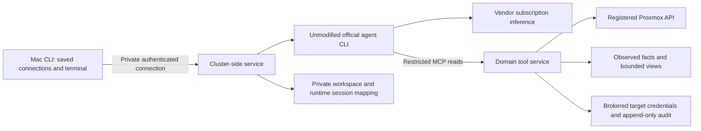

# Architecture

> **Status: binding target design; not implemented.** Technology and packaging choices from the archived implementation are candidates, not defaults. [ADR-0012](../adr/0012-managed-agent-runtime-and-cli-first-stages.md) defines this boundary.

## What runs where

| Component | Responsibility |
|---|---|
| Mac client | Choose a saved instance, authenticate, enter messages, render events, cancel/reconnect. No target calls, policy, provider tokens or authoritative memory. |
| Cluster-side service | Verify instance identity, associate owner/session/runtime, launch/stream/interrupt/resume supported sessions and enforce outer limits. |
| Official runtime | Subscription authentication, model/tool iteration, native transcript/session persistence and compaction. We configure supported controls rather than modify the binary or reimplement its loop. |
| Tool service | Validate and authorize typed reads, broker the read credential, apply output limits/redaction/untrusted markers, persist observations and audit outcomes. |
| Workspace | Owner notes, deterministic observations and private session mapping. Native runtime history is retained separately; no second authoritative transcript store. |

A dedicated guest hosts the service and runtime; its location in the cluster is recorded so later changes cannot unknowingly stop the harness. There is no application installed on each discovered Proxmox node. Model inference can later live on another machine without moving the runtime or memory to the Mac.

## Ownership of the article's layers

| Layer | Stage 1 ownership |
|---|---|
| Model | Official runtime/provider; one subscription-backed combination must be proven. |
| Tools | Domain-owned schemas, target allowlist, validation, credentials, read-only execution and bounded output. MCP is a tool connection, not the owner's primary interface. |
| Context | Runtime owns the conversation window. Harness supplies compact fresh facts, owner-approved notes and versioned operator instructions through supported interfaces. |
| Permission | Harness authorizes domain reads; Proxmox enforces least privilege; runtime isolation prevents native-tool bypass. No model-visible owner channel. |
| Control | Wrapper bounds the session and cancellation; tool service bounds each request independently. Provider/runtime stop behavior is verified, not assumed. |
| Persistence | Native runtime history plus service-owned mapping/notes/observations and protected credential/audit state. Store choice remains open until a scoped implementation decision. |
| Orchestration | One active run. Lifecycle events for presentation/audit only; no scheduler, subagents or generic hook system. |
| Evaluation | Fixture/failure tests from the first increment, live-model fixture tasks, then a separate manual lab gate. |
| Surface | One core, CLI first. Future GUI uses the same session/domain API and authorization. |

## Boundary rules

Interfaces parse, call a service and render; adapters perform typed I/O with deadlines and safe errors; policy/rendering/parsing remain pure where possible. Runtime integration has one concrete implementation first, not a general provider framework. Library/framework language choice is not committed by the old package tree.

Subscription credentials remain in the runtime's supported protected store. Proxmox credentials remain in the broker, inaccessible to model-directed filesystem/shell tools. The tool principal cannot invoke owner configuration or approvals. A common host, process UID or prompt alone is not proof of separation. Verify supported tool restrictions and OS/process isolation before connecting the lab.

The private client transport must authenticate both the owner and expected instance and encrypt traffic. SSH forwarding or explicitly trusted HTTPS are candidates; selection is open. Do not expose a runtime listener publicly or assume loopback/LAN naming is authorization. A second GUI host would need explicit pairing/authentication later.

## Read flow

Owner request → selected instance/session → runtime asks for an allowed tool → validate/authorize → brokered Proxmox read → redacted, bounded typed result with source/time → audit → runtime answer. An audit-storage failure refuses the result. A failed source gives a partial/unavailable result, not invented data or credential escalation.

For writes there is no alternate path: future stored plan → deterministic preview/tier → authenticated owner approval → re-preflight → durable executor → verify → audit. [Safety](safety-model.md) defines this contract. A runtime's generic approval prompt is not domain approval.

## Decisions deferred to the first proof

Select the first runtime (Claude Code proposed), one guest/install method, one private transport, required storage and how to enforce effective isolation/limits. Do not carry Postgres, DBOS, FastAPI, a frontend build or public OAuth into the deployment just because they exist in the snapshot. Equally, do not invent replacement infrastructure solely to avoid reuse. Record a current requirement and the evidence for each adoption.
