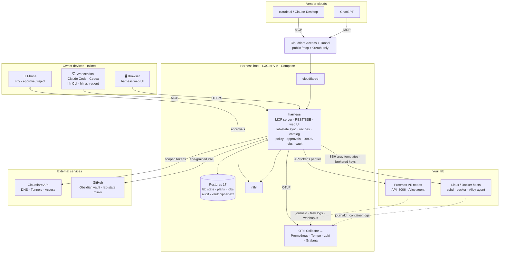

# Architecture

> **Status: specification.** It describes the target design. The decisions behind it are recorded in [ADRs](../adr/). Terms follow the [glossary](../../GLOSSARY.md).

## System overview: what runs where



| Piece | Runs on | What it does |
|---|---|---|
| **harness** container | The harness host (an LXC or VM in the lab) | The control plane. It runs the MCP server for agents, REST and SSE for the UI and CLI, and serves the web UI. It holds the lab-state sync, the recipe runtime, the catalog, the policy engine, approvals, DBOS durable jobs, the audit writer and the secrets vault. It runs no AI model. |
| **Postgres** | Harness host | The one database: lab state, plans, approvals, job state (DBOS), the append-only audit log, and vault ciphertext. The vault's master key lives outside it. |
| **OTel Collector, Prometheus, Tempo, Loki, Grafana** | Harness host, or an observability stack the lab already runs | Traces, metrics and logs for the harness. Loki also stores the **lab logs** behind `logs.query`. |
| **ntfy** | Harness host | Push notifications and approval buttons to the owner's phone |
| **cloudflared** | Harness host | Publishes **only** the `/mcp` and OAuth endpoints, so claude.ai and ChatGPT can reach the harness. Everything else stays on the tailnet. |
| **Proxmox VE nodes** | Your hardware | The target. The harness calls the API with privilege-separated tokens. An Alloy agent on each node ships journald logs to Loki. |
| **Linux and Docker hosts** | Your VMs, LXCs or machines | Targets reached over SSH. The harness uses fixed argv templates and keys that stay in the vault. |
| **Cloudflare API** | Cloudflare | DNS, tunnels and Access, managed with narrow tokens |
| **GitHub** | GitHub | The Obsidian vault repo (tasks and notes), plus an optional repo mirroring the lab documents for change history |
| **Workstation** | Owner's machine | Claude Code or Codex (signed in with the owner's own subscriptions), the `hh` CLI, and `hh ssh-agent` for brokered SSH |
| **Browser** | Owner's machine | The web UI, which replaces the Proxmox web UI. Tailnet only, passkey login. |
| **Phone** | Owner's phone | Receives ntfy notifications. The owner approves or rejects plans there. |
| **claude.ai, ChatGPT** | Vendor clouds | Remote MCP clients that use the owner's subscriptions. They reach the harness only through the Access-protected tunnel. |

Network rule: **everything is on the tailnet except the public MCP endpoint**, and that endpoint is protected by OAuth plus Cloudflare Access ([threat-model.md](threat-model.md)).

## Context

```
  Owner's AI clients (owner's subscriptions)                Owner
  ┌───────────────────────────────────────────┐   ┌──────────────────────┐
  │ claude.ai / Claude Desktop / mobile       │   │ phone: ntfy app      │
  │ ChatGPT (developer-mode connector)        │   │ terminal: hh CLI     │
  │ Claude Code · Codex CLI (on workstation)  │   │ (later) web UI       │
  └───────────────┬───────────────────────────┘   └──────────┬───────────┘
                  │ MCP (streamable HTTP, OAuth 2.1)          │ approvals, jobs, inventory
   public: via Cloudflare Tunnel + Access                     │ (tailnet only)
   private: tailnet                                           │
                  ▼                                           ▼
  ┌────────────────────────────── control plane ──────────────────────────────┐
  │  MCP server ── tool / resource / prompt registry (from capabilities)      │
  │  Policy engine ── risk tiers, floors, approval requirements               │
  │  Plan store ── immutable plans, previews, hashes                          │
  │  Approvals ── out-of-band, single-claim, expiring                         │
  │  Jobs (DBOS) ── durable apply, UPID tracking, verification, outcomes      │
  │  Inventory ── typed read model, refreshed by sync workflows & events      │
  │  Audit log ── append-only: request → plan → approval → job → outcome      │
  │  Vault ── encrypted capability tokens, key rotation                       │
  │  Event ingest ── Proxmox webhooks, schedules, reminders → ntfy            │
  │  Telemetry ── OTel traces/metrics/logs; client usage ingest               │
  └───────┬───────────────┬───────────────┬───────────────┬──────────────────┘
          │ capability adapters (typed, timeouts, error mapping)              │
          ▼               ▼               ▼               ▼                  ▼
     Proxmox VE API   Linux hosts      Docker hosts    Cloudflare API    GitHub (Obsidian
     (per-capability  (SSH: typed     (SSH: compose,   (scoped tokens)   vault repo)
      tokens, pools)   argv, sudoers)   engine)
```

## Containers (deployment units)

| Unit | Contents | Notes |
|---|---|---|
| `harness` | FastAPI app: the MCP server, REST for the CLI/UI, the DBOS runtime, sync workers, the event endpoints | One process type, scaled to one replica in v1. DBOS runs workflows in-process; no separate worker or queue. |
| `postgres` | Postgres 17. Holds app tables, DBOS system tables, the audit log and the vault. | Volume, healthcheck, nightly `pg_dump` to PBS or a NAS. |
| `otel-collector` | Receives OTLP from the harness and from Claude Code/Codex usage telemetry | Exports to the observability stack. |
| `grafana`, `prometheus`, `tempo`, `loki` | Observability stack. Optional if the lab already runs one. | Point the collector at the existing stack instead. |
| `ntfy` | Self-hosted push notifications and approval actions | The owner's phone subscribes over the tailnet or through the tunnel. |
| `cloudflared` | Tunnel for the **public MCP endpoint only** | claude.ai and ChatGPT connectors call from the vendor's cloud, so they need a public HTTPS URL. Everything else stays on the tailnet. |

Everything runs with Docker Compose on one host, typically an LXC or VM in the lab. The harness must not run on a node it is allowed to reboot without a warning in the plan preview.

## Internal structure (code layout)

Distribution and import names:

| Package | Distribution | Import |
|---|---|---|
| Core | `homelab-harness` | `homelab_harness` |
| SDK | `homelab-harness-sdk` | `homelab_harness_sdk` |
| Capability `X` | `homelab-harness-X` | `homelab_harness_X` |
| CLI | `hh` (a console script installed with the CLI package) | — |

```
packages/
  core/                  # control plane; depends on nothing in capabilities/
    api/                 #   interface: FastAPI routes (CLI/UI), MCP mount, webhooks
    mcp/                 #   MCP server: builds tools/resources/prompts from capability manifests
    plans/               #   Plan model, hashing, preview rendering, plan store
    policy/              #   tiering rules, floors, policy config loader (pure logic)
    approvals/           #   approval state machine, ntfy actions, single-claim
    jobs/                #   DBOS workflows: apply, poll external task, verify, outcome
    labstate/            #   typed lab model, sync workflows, change events, lab-document renderers, git mirror
    logs/                #   Loki query service (dedup, trim, budget) for logs.query
    catalog/             #   registry + search over data sources, recipes, steps, templates, docs
    recipes/             #   recipe runtime: input resolution (refs → lab state), composition, plan building
    ui_api/              #   REST + SSE for the web UI, data-source endpoints, layout storage
    audit/               #   append-only audit writer + queries
    db/                  #   async engine, sessions, declarative base, migrate command
    migrations/          #   Alembic scripts (shipped in the wheel)
    secrets/             #   envelope-encrypted vault, grants, brokers (ssh-sign, egress), intake — see secrets.md
    events/              #   ingest, schedules, reminders, notification routing
    telemetry/           #   OTel setup, redaction, usage ingest
  sdk/                   # the capability contract: base classes, decorators, test kit
capabilities/
  proxmox/  linux/  docker/  cloudflare/  obsidian/
    adapter.py           #   typed external calls (no policy, no DB)
    tools.py             #   read tools + plan_* tools (declare tier hints, schemas)
    sync.py              #   lab-state sync for this domain (read-only)
    data_sources.py      #   @data_source definitions (catalog)
    recipes/             #   @recipe definitions + script recipes (recipes.md)
    steps/               #   shared executor steps (idempotency declared)
    resources.py         #   MCP resources (lab documents for this domain)
    steering/            #   capability-specific skills/runbooks
    tests/               #   fixtures + contract kit + unit tests
    manifest.toml        #   name, version, required credentials, tool list
recipes/                 # cross-capability composite recipes
steering/                # steering pack (operator persona, safety, runbooks) + reference/ (curated Proxmox/ZFS/Cloudflare/Docker docs)
ui/                      # React web UI (ui.md): objects/, tabs/, actions/, templates/, routes/
cli/                     # `hh` Typer CLI (thin client of the REST API)
evals/                   # eval suites (fixture replay, golden transcripts, live nested-PVE)
deploy/                  # compose files, otel config, grafana dashboards
```

**Dependency rule:**
- `capabilities/*` may import `sdk`, never `core`.
- `core` discovers capabilities through entry points.
- Adapters never touch the database, and planners never perform writes.

This is the seam that lets a coding agent add a capability without touching the core. [extending.md](extending.md) covers it.

## The central flow: plan, approve, apply

```
client ──call── proxmox.disk.plan_zfs_pool(node, disks, layout="stripe", name)
                │
                ├─ planner: resolve disks by serial → preflight (empty? not in use? SMART ok?)
                ├─ preview: devices, capacity, redundancy=none, exact command, rollback="destroy pool"
                ├─ policy: kind=zfs.create → T3 (floor) → approval=required, typed-confirm=pool name
                └─ plan stored (immutable, sha256 over canonical JSON) → returns plan_id + preview
client ◄─────── "Plan p_7f3 needs your approval. I've sent it to your phone."

owner's phone ◄─ ntfy: preview + [Approve] [Reject]
owner ── approve (T3: type pool name in the CLI or UI) ──► approvals: claim once, bind to plan hash

jobs (DBOS workflow, id = plan_id):
  1. re-run preflight against live state ── drift? → outcome=cancelled (stale plan)
  2. execute steps (each a DBOS step; idempotency key = plan_id + step)
  3. poll UPID / command result until terminal
  4. verify: read the target and compare with the planned state
  5. outcome + audit + ntfy summary
client ── proxmox.job.get(plan_id) / resource job://p_7f3 ──► outcome, verification, task log excerpt
```

Key properties:
- **Plans are immutable.** Changing anything produces a new plan with a new hash. An approval applies to exactly one hash.
- **Low tiers can auto-approve.** T0 never needs a plan. T1 can auto-approve when policy allows it, for example a start, stop or snapshot inside the agent pool. The plan, job and audit still exist; only the human step is skipped.
- **Approvals cannot come from MCP.** MCP exposes no approve tool. Approvals come only from the authenticated owner channels: the ntfy action callback with a signed, single-use URL, the CLI, and later the UI.
- **Jobs are durable.** If the harness restarts mid-job, DBOS resumes from the last completed step. A step whose external effect is ambiguous ends the job as `uncertain` and is not replayed.
- **Drift is detected through Proxmox's own checks.** Proxmox guest config has a `digest`. Plans record it, and apply passes it back, so a concurrent change makes Proxmox reject the write.

## Lab state, documents and logs

The lab state is the deterministic picture of the lab. Agents and the UI read it, so agents don't do discovery. The full design is in [lab-state.md](lab-state.md).
- **Sync.** Sync workflows refresh it on a schedule (30 s, 5 min or 1 h, depending on the entity) and on Proxmox webhooks. Every row carries `as_of` and `source`. Changes emit `lab.changed` events, which feed the UI over SSE, ntfy and the optional Git mirror.
- **Lab documents.** `lab://…` documents are rendered deterministically within token budgets and served over MCP, REST and the CLI.
- **Preflight still reads live.** A plan never trusts the lab state; preflight always reads live state.
- **Time series** (CPU, memory, I/O) come from Proxmox RRD or Prometheus through `metrics` data sources. The lab state stores no time series.
- **Logs.** Node journals, Proxmox task logs and container logs go to Loki. `logs.query` returns de-duplicated lines within a budget.

## How the parts fit

```
            sync (read tokens) ──► lab state ──► renderers ──► lab:// docs ─┐
targets ──► collectors ─────────► Loki ───────► logs.query ─────────────────┤──► MCP (agents)
                                                                             ├──► REST/SSE (UI)
catalog: data sources · recipes · steps · templates · docs ─────────────────┤──► hh CLI
recipes ──► plans (preflight live) ──► approvals ──► DBOS jobs ──► verify ──► lab.sync
                                                         └── audit · traces · failure class
```

## Data model (core tables)

| Table | Purpose | Notable constraints |
|---|---|---|
| `targets` | Registered clusters, hosts, accounts and repos | unique `(kind, name)` |
| `credentials` | Encrypted capability tokens with scope metadata and expiry | unique `(target_id, capability, tier)` |
| `lab_*` | Lab-state entities ([lab-state.md](lab-state.md)): `clusters`, `nodes`, `guests`, `storages`, `zfs_pools`, `disks`, `networks`, `firewall`, `backups`, `hosts`, `stacks`, `tunnels`, `dns_records`, `access_apps`, `annotations` | refreshed by sync; carry `as_of`, `source` |
| `lab_changes` | Change events (entity, field, old → new) | append-only; feeds SSE, ntfy and the Git mirror |
| `lab_profile` | The owner's lab conventions ([onboarding.md](onboarding.md#lab-profile)) | one row per field |
| `catalog_entries` | Searchable index of data sources, recipes, steps, templates and docs | unique `(kind, id, version)`; FTS index |
| `ui_layouts` | Dashboard and panel layouts and widget configs | versioned per owner |
| `plans` | Immutable plan documents | `hash` unique; `kind`, `tier`, `target_id`, `created_by_client` |
| `approvals` | Decision per plan | unique `plan_id`; state machine pending → approved, rejected or expired, then claimed; `select_for_update` on transitions |
| `jobs` | Mirrors the DBOS workflow status for querying | `plan_id` unique; `outcome` |
| `job_steps` | Step records with external IDs (UPIDs, command IDs) | unique `(job_id, step_no)` |
| `audit_events` | Append-only log: `kind`, `actor` (`owner`, `system` or `client:<id>`), `plan_id`, `job_id`, `target`, and `data` (identifiers and counts only) | `seq` is a `GENERATED ALWAYS` identity with a unique constraint; triggers reject UPDATE, DELETE and TRUNCATE; the app role should also lack those grants |
| `events` | Ingested target events | dedupe key unique |
| `reminders` | Owner reminders, delivered through DBOS durable sleep | — |
| `usage_samples` | Client usage telemetry, aggregated | — |

## Technology

| Concern | Choice | ADR |
|---|---|---|
| Language and tooling | Python 3.13, uv workspace, ruff, pyright, pytest | [0002](../adr/0002-python-stack.md) |
| API and MCP | FastAPI, with the official MCP Python SDK (FastMCP-style server) mounted on it; streamable HTTP; spec 2026-07-28 | [0003](../adr/0003-mcp-first-bring-your-own-ai.md) |
| Durable execution | DBOS on Postgres; replaces Celery and Redis | [0004](../adr/0004-dbos-durable-jobs.md) |
| Data | Postgres 17, SQLAlchemy 2 (async), Alembic | [0002](../adr/0002-python-stack.md) |
| Proxmox client | Own typed adapter over `httpx`; proxmoxer is used only as a reference | [capabilities/proxmox.md](capabilities/proxmox.md) |
| SSH | `asyncssh` with fixed argv templates; no shell interpolation | [capabilities/linux-docker.md](capabilities/linux-docker.md) |
| Observability | OpenTelemetry → Collector → Prometheus, Tempo, Loki, Grafana; structlog JSON | [observability.md](observability.md) |
| Notifications and approvals | ntfy (self-hosted) with action buttons | [0006](../adr/0006-ntfy-approvals.md) |
| Network | Tailscale for everything private; Cloudflare Tunnel plus Access for the public MCP endpoint only | [threat-model.md](threat-model.md) |
| CLI | Typer, as a thin REST client | — |
| Web UI | React 19, Vite, TypeScript strict, TanStack Router + Query, shadcn/ui + Tailwind 4, SSE live updates, types generated from OpenAPI; dockview, react-grid-layout and xterm.js arrive in later increments | [ui.md](ui.md), [ADR-0011](../adr/0011-web-ui-stack.md) |
| Log collection | Grafana Alloy (or the OTel Collector) on each node, sending to Loki | [lab-state.md](lab-state.md#lab-logs) |
| Secrets in Git | SOPS + age, for deploy config only | — |
